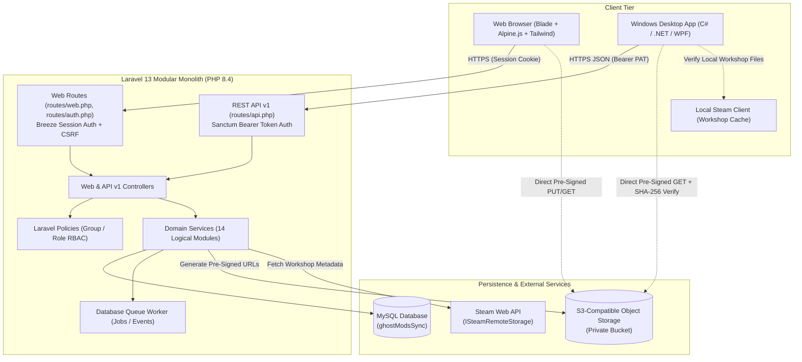
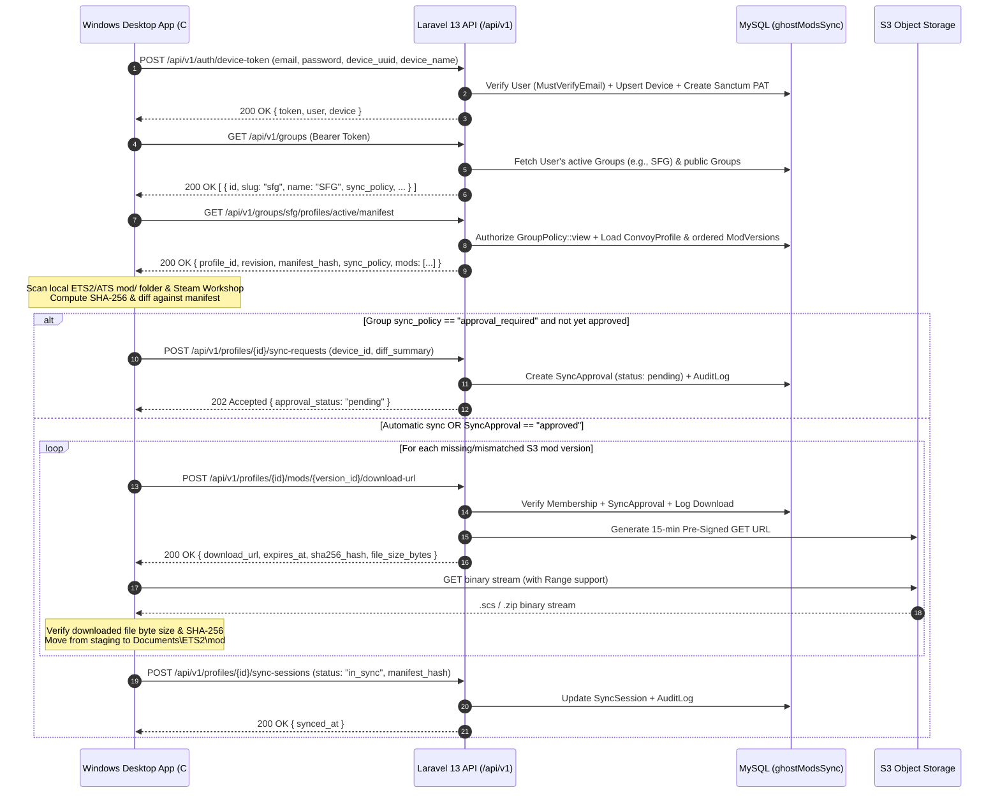

# Ghost ModSync — System Architecture (`docs/03-system-architecture.md`)

**Date:** 2026-11-09  
**Role:** Lead Software Architect  
**Status:** Baseline Architecture Reference

---

## 1. High-Level System Context

Ghost ModSync consists of three primary runtime tiers:
1. **Laravel 13 Modular Monolith Backend (`c:\xampp\htdocs\ghostModSync`):** Serves both the Blade + Alpine.js + Tailwind CSS Web Application (via `web` session guard) and the versioned JSON REST API (`/api/v1/*` via `sanctum` token guard).
2. **MySQL Relational Database (`ghostModsSync`):** Stores users, devices, groups (VTCs), memberships, permissions, mod metadata, mod versions, dependency graphs, convoy profiles, sync states, and audit logs.
3. **S3-Compatible Object Storage:** Stores immutable `.scs` and `.zip` mod binary archives in a private bucket, accessed by browsers and the Windows C#/.NET WPF desktop client exclusively via short-lived cryptographic pre-signed URLs.



---

## 2. Logical Module Organisation (14 Modules)

To adhere to **Laravel 13 conventions** without introducing over-engineered custom autoloaders or microservices, Ghost ModSync uses a **Modular Monolith** organized by domain namespace inside standard Laravel directories (`app/Enums`, `app/Models`, `app/Policies`, `app/Services`, `app/Http/Controllers`, `app/Http/Requests`, `app/Http/Resources/V1`):

| # | Logical Module | Core Models | Core Service / Action Classes | Core Policy / Guard |
| :--- | :--- | :--- | :--- | :--- |
| **1** | **Authentication** | `User`, `PersonalAccessToken` | `Auth\DeviceTokenService` | Breeze `web` guard, Sanctum `sanctum` guard |
| **2** | **Users** | `User` | `Users\UserProfileService` | `UserPolicy` |
| **3** | **Devices** | `Device` | `Devices\DeviceRegistrationService` | `DevicePolicy` |
| **4** | **Groups** | `Group` | `Groups\GroupManagementService` | `GroupPolicy` |
| **5** | **Memberships** | `GroupMembership`, `GroupInvitation` | `Memberships\MembershipService`, `Memberships\InvitationService` | `GroupMembershipPolicy` |
| **6** | **Permissions** | — (Pivot Role + Matrix) | `Permissions\GroupPermissionService` | Evaluated inside Policies & Gates |
| **7** | **Games** | `Game`, `GameVersion` | `Games\GameCompatibilityService` | Read-only reference / Admin managed |
| **8** | **Mods** | `Mod` | `Mods\ModCatalogueService` | `ModPolicy` |
| **9** | **Mod Versions** | `ModVersion` | `Mods\ModVersionService` | `ModVersionPolicy` |
| **10** | **Mod Sources** | `ModSource` | `Mods\S3ModStorageService`, `Mods\SteamWorkshopService` | Scoped via `ModVersionPolicy` |
| **11** | **Dependencies** | `ModDependency` | `Mods\DependencyResolverService` (DAG cycle check) | Scoped via `ModPolicy` |
| **12** | **Convoy Profiles** | `ConvoyProfile`, `ConvoyProfileMod` | `Profiles\ConvoyProfileService`, `Profiles\ManifestBuilderService` | `ConvoyProfilePolicy` |
| **13** | **Synchronisation** | `SyncSession`, `SyncApproval` | `Sync\SyncCoordinatorService`, `Sync\SyncApprovalService` | `SyncPolicy` |
| **14** | **Audit Logging** | `AuditLog` | `Audit\AuditLoggerService` | `AuditLogPolicy` (Group Owner/Admin read-only) |

### Directory Blueprint (`app/`)
```text
app/
├── Enums/
│   ├── GameCode.php                 (ets2, ats)
│   ├── GroupVisibility.php          (public, private)
│   ├── GroupRole.php                (owner, admin, mod_manager, convoy_dispatcher, member)
│   ├── MembershipStatus.php         (active, pending, invited, banned)
│   ├── ModSourceType.php            (s3_upload, steam_workshop)
│   ├── DependencyType.php           (requires, conflicts_with)
│   ├── SyncPolicyMode.php           (automatic, approval_required)
│   └── SyncStatus.php               (in_sync, out_of_sync, syncing, pending_approval, failed)
├── Http/
│   ├── Controllers/
│   │   ├── Auth/                    (Existing Breeze Controllers)
│   │   ├── Web/                     (Blade Controllers: GroupController, ModController, ConvoyProfileController, etc.)
│   │   └── Api/V1/                  (Desktop Client REST Controllers: AuthController, DeviceController, ManifestController, SyncController)
│   ├── Requests/
│   │   ├── Auth/
│   │   ├── Web/
│   │   └── Api/V1/
│   └── Resources/
│       └── V1/                      (GroupResource, ConvoyProfileManifestResource, ModVersionResource, SyncSessionResource)
├── Models/                          (Eloquent Models for all 14 modules)
├── Policies/                        (GroupPolicy, ModPolicy, ConvoyProfilePolicy, DevicePolicy, etc.)
└── Services/                        (Domain Services grouped by module)
```

---

## 3. Architecture Decision Records (ADRs)

### ADR-01: Modular Monolith in Standard Laravel Structure vs. Microservices or Custom DDD Packages

- **Reason for Choosing:** A single Laravel 13 modular monolith allows Web (Blade) and Desktop API (`/api/v1/*`) controllers to share Eloquent models, validation rules, authorization policies, domain services, and database transactions with zero network serialization overhead.
- **Alternatives Considered:**
  1. *Separate Web and API Microservices:* Doubles deployment, authentication, and database migration complexity.
  2. *Custom Composer Sub-Packages (`modules/*/composer.json`):* Deviates from standard Laravel conventions (`php artisan make:*` commands expect `app/Models`, `app/Policies`, etc.).
- **Advantages:** Fast development velocity, atomic DB transactions across modules (e.g., creating a `ModVersion` + `ModSource` + `AuditLog` in `DB::transaction()`), standard Laravel tooling compatibility.
- **Disadvantages:** Requires discipline to prevent controllers from bypassing domain services or writing cross-module spaghetti queries.
- **Risks & Mitigations:** Risk of fat controllers; mitigated by enforcing thin controllers that delegate business logic to `app/Services/*` and authorization to `app/Policies/*`.
- **Effect on Desktop/API Integration:** `/api/v1/*` controllers invoke the exact same `ManifestBuilderService` and `SyncCoordinatorService` as the Blade web interface, guaranteeing 100% behavioral parity.

---

### ADR-02: Dual-Guard Authentication (Breeze Session for Web + Sanctum PATs for Desktop API)

- **Reason for Choosing:** Preserves the already installed and tested Laravel Breeze (`v2.4.2`) Blade authentication (`web` session guard) while adding stateless, device-scoped Bearer tokens via Laravel Sanctum (`^4.0`) for the C#/.NET WPF client.
- **Alternatives Considered:**
  1. *Laravel Passport (OAuth2 Server):* Heavyweight RSA key management and OAuth grant tables unnecessary for a first-party Windows desktop client.
  2. *Replacing Breeze with Jetstream or Fortify:* Violates confirmed instruction not to replace existing Breeze authentication.
- **Advantages:** Lightweight, native to Laravel 13, supports token abilities (`['sync:read', 'sync:write', 'mods:download']`), and links each token directly to a `Device` record.
- **Disadvantages:** Personal Access Tokens are long-lived unless explicitly configured with expiration or rotation.
- **Risks & Mitigations:** Token leakage on a compromised Windows PC; mitigated by binding each Sanctum token ID (`personal_access_token_id`) to a `devices` row so users or group admins can revoke individual devices immediately, and by encrypting the token at rest on Windows using DPAPI (`ProtectedData`).
- **Effect on Desktop/API Integration:** The WPF client authenticates once at `/api/v1/auth/device-token`, stores the Bearer token in Windows Credential Manager / DPAPI, and includes `Authorization: Bearer <token>` on all subsequent API calls.

---

### ADR-03: Direct-to-S3 Pre-Signed Transfers with SHA-256 Content Addressing

- **Reason for Choosing:** ETS2 and ATS map, sound, and graphics mods routinely exceed 500 MB–5 GB. Streaming gigabyte files through Apache/PHP workers causes memory exhaustion, worker starvation, and HTTP gateway timeouts.
- **Alternatives Considered:**
  1. *Streaming uploads/downloads through Laravel (`Storage::download()`):* Fails under concurrent convoy downloads (e.g., 30 VTC drivers downloading a 2 GB map mod simultaneously prior to a convoy).
  2. *Public S3 Bucket URLs:* Exposes private VTC mods to unauthorized scraping and hotlinking.
- **Advantages:** Offloads 100% of binary bandwidth to S3-compatible storage while keeping the bucket strictly private (`BlockPublicAccess`). Laravel acts purely as the authorization and manifest control plane.
- **Disadvantages:** Requires a two-step upload flow (1: Request upload URL + register pending version, 2: Confirm upload completion) and CORS configuration on the S3 bucket for browser uploads.
- **Risks & Mitigations:** Risk of a corrupted or tampered file being uploaded or downloaded; mitigated by requiring the uploader and desktop client to compute and verify a **64-character SHA-256 digest** (`sha256_hash`) and exact `file_size_bytes`.
- **Effect on Desktop/API Integration:** The WPF client can use `.NET HttpClient` with HTTP Range headers directly against the S3 pre-signed URL to support multi-threaded or resumable downloads, followed by local `System.Security.Cryptography.SHA256` verification.

---

### ADR-04: Hybrid Mod Source Architecture (Direct S3 Uploads + Steam Workshop References)

- **Reason for Choosing:** Confirmed Requirement #1 mandates supporting both custom/VTC-hosted `.scs`/`.zip` files and Steam Workshop mods.
- **Alternatives Considered:**
  1. *Re-uploading Steam Workshop files to S3:* Violates Steam Workshop redistribution norms and wastes S3 storage when Steam already distributes Workshop content to subscribers.
- **Advantages:** Respects mod authors' distribution channels while allowing a single `ConvoyProfile` load order to seamlessly interleave S3-hosted mods and Steam Workshop mods.
- **Disadvantages:** The desktop client must inspect two local locations on Windows:
  - Standard mod directory: `%USERPROFILE%\Documents\Euro Truck Simulator 2\mod` (or `American Truck Simulator\mod`).
  - Steam Workshop directory: `<SteamLibrary>\steamapps\workshop\content\227300\<published_file_id>` (`227300` for ETS2, `270880` for ATS).
- **Risks & Mitigations:** A Steam Workshop mod may update automatically via Steam before a convoy; mitigated by recording the expected `steam_updated_at` / `file_size_bytes` / `sha256_hash` (optional pin) on the `ModVersion` so the desktop client can detect Workshop version drift.
- **Effect on Desktop/API Integration:** Each item in the `/api/v1/.../manifest` JSON array includes `"source_type": "s3_upload" | "steam_workshop"` so the C# client knows whether to request an S3 pre-signed download URL or verify the local Steam Workshop folder.

---

## 4. End-to-End Desktop Synchronisation Sequence


