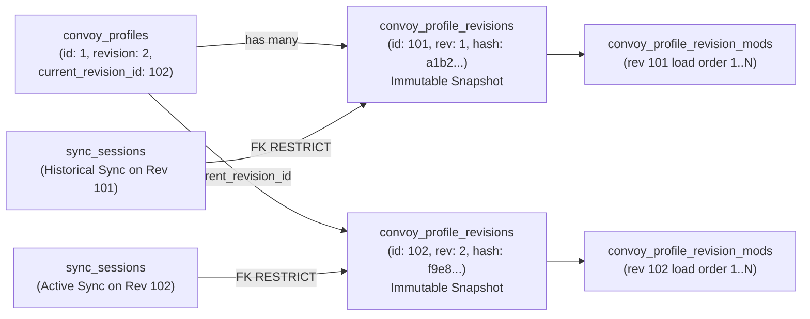

# Ghost ModSync — Relational Database Architecture & Migration Plan (`docs/04-database-design.md`)

**Date:** 2026-11-09  
**Role:** Senior Database Architect (Laravel 13 & MySQL 8.0+ / MariaDB 10.6+)  
**Database Name:** `ghostModsSync` (`InnoDB`, `utf8mb4_unicode_ci`)  
**Status:** Implementation-Ready Relational Architecture (Awaiting Migration Approval)

---

## 1. Entity Review, Missing Entities & Redundancy Analysis (Task 1)

### 1.1 Evaluation of All 16 Domain Entity Areas

| # | Entity Area | Proposed Table(s) | Necessity & Architectural Verdict |
| :--- | :--- | :--- | :--- |
| **1** | **Users and devices** | `users`, `devices`, `personal_access_tokens` | **Necessary.** Separates human identity (`users`) from Windows desktop installations (`devices`) and Sanctum tokens (`personal_access_tokens`). |
| **2** | **Groups and memberships** | `groups`, `group_memberships` | **Necessary.** Supports multi-VTC tenancy (`groups`) and many-to-many user memberships with per-group roles (`group_memberships`). |
| **3** | **Group invitations and join requests** | `group_invitations`, `group_join_requests` | **Refined (Split into 2 Dedicated Tables).** Previously, join requests were overloaded onto `group_memberships.status = 'pending'`. Splitting **`group_join_requests`** from `group_memberships` ensures `group_memberships` only contains actual members (`active`, `suspended`, `banned`) and preserves a full history of applicant messages, rejection reasons, and re-applications. |
| **4** | **Games and game versions** | `games`, `game_versions` | **Necessary.** Normalizes ETS2 (`227300`) and ATS (`270880`) definitions and official SCS patch branches (`1.52`, `1.53`). |
| **5** | **Mods and mod versions** | `mods`, `mod_versions` | **Necessary.** `mods` represents the logical mod catalogue entry; `mod_versions` represents immutable semantic releases. |
| **6** | **Mod assets and storage metadata** | `mod_sources` | **Necessary (1:1 with `mod_versions`).** Stores S3 bucket/disk, `s3_object_key`, `s3_etag`, upload verification timestamp, or Steam Workshop pointers. |
| **7** | **Steam Workshop references** | `mod_sources` | **Consolidated.** Creating a separate `steam_workshop_items` table alongside `mod_sources` would be **redundant** because every `ModVersion` has exactly one distribution backing (`s3_upload` OR `steam_workshop`). Enforced via a MySQL `CHECK` constraint on `mod_sources`. |
| **8** | **Mod dependencies** | `mod_dependencies` | **Necessary.** Models the Directed Acyclic Graph (DAG) of `requires` and `conflicts_with` edges between `mod_versions` and target `mods` / `mod_versions`. |
| **9** | **DLC requirements** | `game_dlcs`, `mod_version_dlc` | **Missing Entity Identified — Added.** Map and cargo mods (e.g., ProMods, Heavy Cargo packs) strictly require specific official SCS DLCs (e.g., *Going East!*, *Scandinavia*, *Iberia*, *West Balkans*). Without `game_dlcs` and `mod_version_dlc`, the desktop client cannot warn drivers about missing Steam DLCs that will crash ETS2/ATS on profile load. |
| **10** | **Group-specific mod approvals** | `group_mod_approvals` | **Missing Entity Identified — Added.** Supports group-specific vetting of specific `mod_versions` (`pending`, `approved`, `rejected`, `revoked`, `tested_by`, `review_notes`) before a version can be pinned in a published Convoy Profile. |
| **11** | **Convoy profiles** | `convoy_profiles` | **Necessary.** Represents the logical convoy configuration header for a group and game, pointing to `current_revision_id` and `working_draft`. |
| **12** | **Convoy profile revisions** | `convoy_profile_revisions` | **Missing Entity Identified — Added.** Previously, `convoy_profiles` only stored an integer `revision` and mutated `convoy_profile_mods` in place, destroying historical load orders. Adding **`convoy_profile_revisions`** provides immutable published snapshots. |
| **13** | **Convoy profile mod entries** | `convoy_profile_mods`, `convoy_profile_revision_mods` | **Refined.** `convoy_profile_mods` holds the editable working draft load order for a profile, while **`convoy_profile_revision_mods`** stores the immutable pinned `mod_version_id` and `load_order` for each published `convoy_profile_revision`. |
| **14** | **Synchronisation sessions** | `sync_sessions`, `sync_approvals` | **Necessary.** Tracks every desktop synchronisation execution (`sync_sessions` — append-only history referencing `convoy_profile_revision_id`) and approval gate (`sync_approvals`). |
| **15** | **Synchronisation session items** | `sync_session_items` | **Missing Entity Identified — Added.** Previously, `sync_sessions` only stored aggregate integer counts (`missing_mods_count`). Adding **`sync_session_items`** records per-mod version outcomes (`already_installed`, `downloaded`, `checksum_failed`, `workshop_missing`, `removed`), byte transfer metrics, and local SHA-256 hashes for full diagnostic traceability. |
| **16** | **Audit logs** | `audit_logs` | **Necessary.** Append-only security and governance log across all groups, users, and devices. |

---

## 2. Complete Entity & Relationship Definitions (Task 2)

Below is the complete specification of all **20 domain tables** (plus Laravel's default `sessions`, `cache`, `jobs`, `password_reset_tokens`, and `personal_access_tokens`).

### 2.1 `users` (Identity & Platform Account)
- **Purpose:** Stores registered human users across the web portal and Windows desktop app.
- **Primary Key:** `id` (`BIGINT UNSIGNED AUTO_INCREMENT`)
- **Foreign Keys:** None.
- **Unique Constraints:**
  - `users_email_unique` (`email`)
  - `users_username_unique` (`username`)
- **Indexes:**
  - `users_steam_id_index` (`steam_id`)
- **Relationships:**
  - `1:N` -> `devices` (`User::devices()`)
  - `1:N` -> `groups` as owner (`User::ownedGroups()`)
  - `1:N` -> `group_memberships` (`User::groupMemberships()`)
  - `M:N` -> `groups` through `group_memberships` (`User::groups()`)
- **Deletion Behaviour:** Soft-protected via `RESTRICT` if the user owns an active `Group` (ownership must be transferred before account deletion); `CASCADE` on `devices` and `group_memberships`; `SET NULL` on `audit_logs`, `mod_versions.uploaded_by`, and `convoy_profile_revisions.published_by`.

| Column | MySQL Data Type | Null | Default | Description |
| :--- | :--- | :--- | :--- | :--- |
| `id` | `BIGINT UNSIGNED` | `NO` | `AUTO_INCREMENT` | Primary key |
| `name` | `VARCHAR(255)` | `NO` | — | Display name |
| `username` | `VARCHAR(50)` | `YES` | `NULL` | Unique handle |
| `email` | `VARCHAR(255)` | `NO` | — | Unique login email |
| `steam_id` | `VARCHAR(32)` | `YES` | `NULL` | 64-bit SteamID64 string |
| `avatar_path` | `VARCHAR(255)` | `YES` | `NULL` | Profile avatar path |
| `email_verified_at` | `TIMESTAMP` | `YES` | `NULL` | Email verification timestamp (`MustVerifyEmail`) |
| `password` | `VARCHAR(255)` | `NO` | — | Bcrypt hash |
| `remember_token` | `VARCHAR(100)` | `YES` | `NULL` | Web session remember token |
| `is_platform_admin` | `TINYINT(1)` | `NO` | `0` | Global platform administrator flag |
| `last_login_at` | `TIMESTAMP` | `YES` | `NULL` | Last login timestamp |
| `created_at` / `updated_at` | `TIMESTAMP` | `YES` | `NULL` | Eloquent timestamps |

---

### 2.2 `devices` (Registered Windows Desktop Clients)
- **Purpose:** Represents a physical/virtual Windows PC running the Ghost ModSync WPF desktop client, bound to a Sanctum token.
- **Primary Key:** `id` (`BIGINT UNSIGNED AUTO_INCREMENT`)
- **Foreign Keys:**
  - `user_id` -> `users.id` (`ON DELETE CASCADE`)
  - `personal_access_token_id` -> `personal_access_tokens.id` (`ON DELETE SET NULL`)
- **Unique Constraints:**
  - `devices_user_id_device_uuid_unique` (`user_id`, `device_uuid`)
- **Indexes:**
  - `devices_personal_access_token_id_index` (`personal_access_token_id`)
  - `devices_last_seen_at_index` (`last_seen_at`)
  - `devices_revoked_at_index` (`revoked_at`)
- **Relationships:**
  - `N:1` -> `users` (`Device::user()`)
  - `1:1` (nullable) -> `personal_access_tokens` (`Device::token()`)
  - `1:N` -> `sync_sessions` (`Device::syncSessions()`)
- **Deletion Behaviour:** Deleted automatically if `user` is deleted; sets `device_id = NULL` on historical `audit_logs` and `sync_approvals`.

| Column | MySQL Data Type | Null | Default | Constraints / Description |
| :--- | :--- | :--- | :--- | :--- |
| `id` | `BIGINT UNSIGNED` | `NO` | `AUTO_INCREMENT` | Primary Key |
| `user_id` | `BIGINT UNSIGNED` | `NO` | — | FK -> `users.id` (`ON DELETE CASCADE`) |
| `personal_access_token_id` | `BIGINT UNSIGNED` | `YES` | `NULL` | FK -> `personal_access_tokens.id` (`ON DELETE SET NULL`) |
| `device_uuid` | `CHAR(36)` | `NO` | — | Client UUID (`UNIQUE (user_id, device_uuid)`) |
| `device_name` | `VARCHAR(120)` | `NO` | — | Windows machine label |
| `os_version` | `VARCHAR(100)` | `YES` | `NULL` | Windows version string |
| `client_version` | `VARCHAR(32)` | `YES` | `NULL` | WPF client semantic version |
| `ets2_mod_path` | `VARCHAR(500)` | `YES` | `NULL` | Local ETS2 `mod/` path |
| `ats_mod_path` | `VARCHAR(500)` | `YES` | `NULL` | Local ATS `mod/` path |
| `steam_library_path` | `VARCHAR(500)` | `YES` | `NULL` | Local Steam Workshop path |
| `last_ip_address` | `VARCHAR(45)` | `YES` | `NULL` | IPv4/IPv6 address |
| `last_seen_at` | `TIMESTAMP` | `YES` | `NULL` | Indexed heartbeat timestamp |
| `revoked_at` | `TIMESTAMP` | `YES` | `NULL` | Indexed revocation timestamp |
| `created_at` / `updated_at` | `TIMESTAMP` | `YES` | `NULL` | Eloquent timestamps |

---

### 2.3 `groups` (VTCs & Gaming Communities)
- **Purpose:** Represents an independent Virtual Trucking Company (such as pilot group **SFG**) or modding community.
- **Primary Key:** `id` (`BIGINT UNSIGNED AUTO_INCREMENT`)
- **Foreign Keys:**
  - `owner_id` -> `users.id` (`ON DELETE RESTRICT`)
- **Unique Constraints:**
  - `groups_slug_unique` (`slug`)
- **Indexes:**
  - `groups_visibility_index` (`visibility`)
  - `groups_owner_id_index` (`owner_id`)
- **Relationships:**
  - `N:1` -> `users` (`Group::owner()`)
  - `1:N` -> `group_memberships`, `group_invitations`, `group_join_requests`, `mods`, `group_mod_approvals`, `convoy_profiles`, `audit_logs`
  - `M:N` -> `users` via `group_memberships` (`Group::members()`)
- **Deletion Behaviour:** Uses `SoftDeletes` (`deleted_at`). Hard deletion cascades to memberships, invitations, join requests, mods, and profiles.

| Column | MySQL Data Type | Null | Default | Description |
| :--- | :--- | :--- | :--- | :--- |
| `id` | `BIGINT UNSIGNED` | `NO` | `AUTO_INCREMENT` | Primary key |
| `owner_id` | `BIGINT UNSIGNED` | `NO` | — | FK to `users.id` (`RESTRICT`) |
| `name` | `VARCHAR(120)` | `NO` | — | Group display name (e.g., `SFG`) |
| `slug` | `VARCHAR(120)` | `NO` | — | URL/API identifier (e.g., `sfg`) |
| `tag` | `VARCHAR(16)` | `YES` | `NULL` | In-game VTC tag (e.g., `[SFG]`) |
| `description` | `TEXT` | `YES` | `NULL` | Group overview |
| `visibility` | `VARCHAR(20)` | `NO` | `'private'` | `public` or `private` |
| `sync_policy` | `VARCHAR(30)` | `NO` | `'automatic'` | `automatic` or `approval_required` |
| `require_join_approval` | `TINYINT(1)` | `NO` | `1` | Require admin review for public joins |
| `require_mod_approval` | `TINYINT(1)` | `NO` | `1` | Require `group_mod_approvals` before profile pinning |
| `logo_path` | `VARCHAR(255)` | `YES` | `NULL` | Group logo path |
| `banner_path` | `VARCHAR(255)` | `YES` | `NULL` | Group banner path |
| `storage_quota_bytes` | `BIGINT UNSIGNED` | `NO` | `53687091200` | Max S3 bytes (default 50 GB; 100 GB for SFG) |
| `created_at` / `updated_at` / `deleted_at` | `TIMESTAMP` | `YES` | `NULL` | Timestamps + SoftDelete |

---

### 2.4 `group_memberships` (Multi-Group User Roles)
- **Purpose:** Many-to-many pivot model linking `users` and `groups` with a per-group role (`owner`, `admin`, `mod_manager`, `convoy_dispatcher`, `member`).
- **Primary Key:** `id` (`BIGINT UNSIGNED AUTO_INCREMENT`)
- **Foreign Keys:**
  - `group_id` -> `groups.id` (`ON DELETE CASCADE`)
  - `user_id` -> `users.id` (`ON DELETE CASCADE`)
  - `invited_by` -> `users.id` (`ON DELETE SET NULL`)
  - `approved_by` -> `users.id` (`ON DELETE SET NULL`)
- **Unique Constraints:**
  - `group_memberships_group_id_user_id_unique` (`group_id`, `user_id`) — **Enforces at the database level that a user can never be a duplicate member of the same group.**
- **Indexes:**
  - `group_memberships_group_id_status_role_index` (`group_id`, `status`, `role`)

| Column | MySQL Data Type | Null | Default | Constraints / Description |
| :--- | :--- | :--- | :--- | :--- |
| `id` | `BIGINT UNSIGNED` | `NO` | `AUTO_INCREMENT` | Primary Key |
| `group_id` | `BIGINT UNSIGNED` | `NO` | — | FK -> `groups.id` (`ON DELETE CASCADE`) |
| `user_id` | `BIGINT UNSIGNED` | `NO` | — | FK -> `users.id` (`ON DELETE CASCADE`) |
| `role` | `VARCHAR(30)` | `NO` | `'member'` | `owner`, `admin`, `mod_manager`, `convoy_dispatcher`, `member` |
| `status` | `VARCHAR(20)` | `NO` | `'active'` | `pending`, `active`, `suspended`, `banned` |
| `invited_by` | `BIGINT UNSIGNED` | `YES` | `NULL` | FK -> `users.id` (`ON DELETE SET NULL`) |
| `approved_by` | `BIGINT UNSIGNED` | `YES` | `NULL` | FK -> `users.id` (`ON DELETE SET NULL`) |
| `joined_at` | `TIMESTAMP` | `YES` | `NULL` | Membership activation timestamp |
| `created_at` / `updated_at` | `TIMESTAMP` | `YES` | `NULL` | `UNIQUE (group_id, user_id)` |

---

### 2.5 `group_invitations` & `group_join_requests`
- **`group_invitations` Purpose:** Stores outbound single-use or multi-use cryptographic invite tokens (`CHAR(64)`) issued by Group Owners/Admins.
  - **PK:** `id` (`BIGINT UNSIGNED`)
  - **FKs:** `group_id` -> `groups.id` (`CASCADE`), `invited_by` -> `users.id` (`CASCADE`)
  - **Unique:** `group_invitations_token_unique` (`token`)
  - **Indexes:** `group_invitations_email_index` (`email`), `group_invitations_expires_at_index` (`expires_at`)

| Column (`group_invitations`) | MySQL Data Type | Null | Default | Constraints / Description |
| :--- | :--- | :--- | :--- | :--- |
| `id` | `BIGINT UNSIGNED` | `NO` | `AUTO_INCREMENT` | Primary Key |
| `group_id` | `BIGINT UNSIGNED` | `NO` | — | FK -> `groups.id` (`ON DELETE CASCADE`) |
| `invited_by` | `BIGINT UNSIGNED` | `NO` | — | FK -> `users.id` (`ON DELETE CASCADE`) |
| `email` | `VARCHAR(255)` | `YES` | `NULL` | Optional target email restriction |
| `token` | `CHAR(64)` | `NO` | — | `UNIQUE` 256-bit hex token |
| `role` | `VARCHAR(30)` | `NO` | `'member'` | Role granted on acceptance |
| `max_uses` | `INT UNSIGNED` | `YES` | `1` | `NULL` = unlimited until expiry |
| `uses_count` | `INT UNSIGNED` | `NO` | `0` | Current redemption counter |
| `expires_at` | `TIMESTAMP` | `NO` | — | Indexed expiration timestamp |
| `revoked_at` | `TIMESTAMP` | `YES` | `NULL` | Manual revocation timestamp |
| `created_at` / `updated_at` | `TIMESTAMP` | `YES` | `NULL` | Eloquent timestamps |

- **`group_join_requests` Purpose:** Stores inbound applications from users requesting to join a `public` group that has `require_join_approval = 1`.
  - **PK:** `id` (`BIGINT UNSIGNED`)
  - **FKs:** `group_id` -> `groups.id` (`ON DELETE CASCADE`), `user_id` -> `users.id` (`ON DELETE CASCADE`), `reviewed_by` -> `users.id` (`ON DELETE SET NULL`)
  - **Indexes:** `group_join_requests_group_user_status_index` (`group_id`, `user_id`, `status`)

| Column (`group_join_requests`) | MySQL Data Type | Null | Default | Constraints / Description |
| :--- | :--- | :--- | :--- | :--- |
| `id` | `BIGINT UNSIGNED` | `NO` | `AUTO_INCREMENT` | Primary Key |
| `group_id` | `BIGINT UNSIGNED` | `NO` | — | FK -> `groups.id` (`ON DELETE CASCADE`) |
| `user_id` | `BIGINT UNSIGNED` | `NO` | — | FK -> `users.id` (`ON DELETE CASCADE`) |
| `message` | `TEXT` | `YES` | `NULL` | Applicant message |
| `status` | `VARCHAR(20)` | `NO` | `'pending'` | `pending`, `approved`, `rejected`, `cancelled` |
| `reviewed_by` | `BIGINT UNSIGNED` | `YES` | `NULL` | FK -> `users.id` (`ON DELETE SET NULL`) |
| `review_notes` | `VARCHAR(500)` | `YES` | `NULL` | Reviewer decision notes |
| `reviewed_at` | `TIMESTAMP` | `YES` | `NULL` | Review decision timestamp |
| `created_at` / `updated_at` | `TIMESTAMP` | `YES` | `NULL` | Eloquent timestamps |

---

### 2.6 `games`, `game_versions` & `game_dlcs` (Simulator & DLC Reference Data)
- **`games`:**
  - **Purpose:** Defines supported truck simulators (`ets2` and `ats`).
  - **PK:** `id` (`BIGINT UNSIGNED`)
  - **Unique:** `games_code_unique` (`code`), `games_steam_app_id_unique` (`steam_app_id`)
- **`game_versions`:**
  - **Purpose:** Tracks simulator patch branches (e.g., ETS2 `1.51`, `1.52`, `1.53`).
  - **PK:** `id` (`BIGINT UNSIGNED`)
  - **FK:** `game_id` -> `games.id` (`ON DELETE CASCADE`)
  - **Unique:** `game_versions_game_id_version_branch_unique` (`game_id`, `version_branch`)
- **`game_dlcs` (New Entity for Requirement #9):**
  - **Purpose:** Catalogue of official SCS Software map, cargo, and tuning DLCs per game (e.g., *Going East!*, *Scandinavia*, *Vive la France !*, *Italia*, *Beyond the Baltic Sea*, *Road to the Black Sea*, *Iberia*, *West Balkans*, *Greece*, *Heavy Cargo Pack*, *Special Transport*).
  - **PK:** `id` (`BIGINT UNSIGNED`)
  - **FK:** `game_id` -> `games.id` (`ON DELETE CASCADE`)
  - **Unique:**
    - `game_dlcs_game_id_code_unique` (`game_id`, `code`) — e.g., `(1, 'dlc_east')`, `(1, 'dlc_north')`, `(1, 'dlc_balkan_w')`
    - `game_dlcs_steam_app_id_unique` (`steam_app_id`)
  - **Columns:** `id`, `game_id`, `code` (`VARCHAR(50)`), `name` (`VARCHAR(120)`), `steam_app_id` (`INT UNSIGNED`), `category` (`VARCHAR(30)` — `map`, `cargo`, `trailer`, `tuning`), `is_active` (`TINYINT(1)`), `created_at`, `updated_at`.

| Table | Column | MySQL Data Type | Null | Default | Constraints / Notes |
| :--- | :--- | :--- | :--- | :--- | :--- |
| `games` | `id` | `BIGINT UNSIGNED` | `NO` | `AUTO_INCREMENT` | Primary Key |
| `games` | `code` | `VARCHAR(16)` | `NO` | — | `UNIQUE` (`ets2`, `ats`) |
| `games` | `name` | `VARCHAR(100)` | `NO` | — | Full simulator title |
| `games` | `steam_app_id` | `INT UNSIGNED` | `NO` | — | `UNIQUE` (`227300`, `270880`) |
| `games` | `default_mod_dir_name` | `VARCHAR(100)` | `NO` | — | Documents subdirectory name |
| `games` | `is_active` | `TINYINT(1)` | `NO` | `1` | Active flag |
| `game_versions` | `id` | `BIGINT UNSIGNED` | `NO` | `AUTO_INCREMENT` | Primary Key |
| `game_versions` | `game_id` | `BIGINT UNSIGNED` | `NO` | — | FK -> `games.id` (`CASCADE`) |
| `game_versions` | `version_branch` | `VARCHAR(32)` | `NO` | — | `UNIQUE (game_id, version_branch)` |
| `game_versions` | `is_current` | `TINYINT(1)` | `NO` | `0` | Current live branch flag |
| `game_versions` | `released_at` | `DATE` | `YES` | `NULL` | Release date |
| `game_dlcs` | `id` | `BIGINT UNSIGNED` | `NO` | `AUTO_INCREMENT` | Primary Key |
| `game_dlcs` | `game_id` | `BIGINT UNSIGNED` | `NO` | — | FK -> `games.id` (`CASCADE`) |
| `game_dlcs` | `code` | `VARCHAR(50)` | `NO` | — | `UNIQUE (game_id, code)` (e.g., `dlc_north`) |
| `game_dlcs` | `name` | `VARCHAR(120)` | `NO` | — | Official DLC name |
| `game_dlcs` | `steam_app_id` | `INT UNSIGNED` | `NO` | — | `UNIQUE` Steam AppID |
| `game_dlcs` | `category` | `VARCHAR(30)` | `NO` | `'map'` | `map`, `cargo`, `trailer`, `tuning` |
| `game_dlcs` | `is_active` | `TINYINT(1)` | `NO` | `1` | Active flag |

---

### 2.7 `mods`, `mod_versions`, `mod_sources`, `mod_version_dlc`, `mod_dependencies`, `group_mod_approvals`

#### `mods` (Logical Mod Catalogue)
- **Purpose:** Logical mod entry owned by a group and scoped to a specific game (`ets2` or `ats`).
- **PK:** `id` (`BIGINT UNSIGNED`)
- **FKs:** `group_id` -> `groups.id` (`CASCADE`), `game_id` -> `games.id` (`RESTRICT`), `created_by` -> `users.id` (`SET NULL`)
- **Unique:** `mods_group_id_game_id_slug_unique` (`group_id`, `game_id`, `slug`)
- **Indexes:** `mods_group_id_game_id_is_active_index` (`group_id`, `game_id`, `is_active`)
- **Deletion Behaviour:** `SoftDeletes` (`deleted_at`).

#### `mod_versions` (Immutable Version History)
- **Purpose:** Specific semantic version release of a `Mod` (`1.0.0`, `2.72.0`).
- **PK:** `id` (`BIGINT UNSIGNED`)
- **FKs:**
  - `mod_id` -> `mods.id` (`ON DELETE CASCADE`)
  - `uploaded_by` -> `users.id` (`ON DELETE SET NULL`)
  - `min_game_version_id` -> `game_versions.id` (`ON DELETE SET NULL`) *(optional FK alongside string `min_game_version` for fast comparison)*
- **Unique:** `mod_versions_mod_id_version_number_unique` (`mod_id`, `version_number`)
- **Indexes:**
  - `mod_versions_sha256_hash_index` (`sha256_hash`)
  - `mod_versions_status_index` (`status`)
- **Database Check Constraint (MySQL 8.0.16+ / MariaDB 10.2.1+):**
  - `chk_mod_versions_sha256_format`: `CHECK (sha256_hash IS NULL OR sha256_hash REGEXP '^[a-f0-9]{64}$')`
- **Deletion Behaviour:** `SoftDeletes` (`deleted_at`); hard deletion is blocked (`RESTRICT`) if referenced by any `convoy_profile_mods`, `convoy_profile_revision_mods`, or `sync_session_items`.

#### `mod_sources` (Storage & Steam Workshop Metadata — 1:1 with `mod_versions`)
- **Purpose:** Stores the exact delivery mechanism (`s3_upload` vs. `steam_workshop`) for a `ModVersion`.
- **PK:** `id` (`BIGINT UNSIGNED`)
- **FK:** `mod_version_id` -> `mod_versions.id` (`ON DELETE CASCADE`)
- **Unique:** `mod_sources_mod_version_id_unique` (`mod_version_id`) — strictly `1:1`.
- **Indexes:** `mod_sources_steam_published_file_id_index` (`steam_published_file_id`)
- **Database Check Constraint:**
  - `chk_mod_sources_backing`: Ensures an `s3_upload` row always has `s3_object_key IS NOT NULL` and a `steam_workshop` row always has `steam_published_file_id IS NOT NULL`.

#### `mod_version_dlc` (Mod Version DLC Requirements — M:N Pivot)
- **Purpose:** Declares which official SCS DLCs (`game_dlcs`) are required by a specific `ModVersion`.
- **PK:** `id` (`BIGINT UNSIGNED`)
- **FKs:**
  - `mod_version_id` -> `mod_versions.id` (`ON DELETE CASCADE`)
  - `game_dlc_id` -> `game_dlcs.id` (`ON DELETE CASCADE`)
- **Unique:** `mod_version_dlc_unique` (`mod_version_id`, `game_dlc_id`)
- **Columns:** `id`, `mod_version_id`, `game_dlc_id`, `is_required` (`TINYINT(1)` default `1`), `created_at`, `updated_at`.

#### `mod_dependencies` (Mod Dependency & Conflict DAG)
- **Purpose:** Directed edges (`requires` or `conflicts_with`) from a `ModVersion` to another `Mod` (and optionally a pinned `related_mod_version_id`).
- **PK:** `id` (`BIGINT UNSIGNED`)
- **FKs:**
  - `mod_version_id` -> `mod_versions.id` (`ON DELETE CASCADE`)
  - `related_mod_id` -> `mods.id` (`ON DELETE CASCADE`)
  - `related_mod_version_id` -> `mod_versions.id` (`ON DELETE SET NULL`)
- **Unique:** `mod_dep_version_related_type_unique` (`mod_version_id`, `related_mod_id`, `dependency_type`)

#### `group_mod_approvals` (Group-Specific Mod Version Vetting — Requirement #10)
- **Purpose:** Tracks group-level quality assurance, security scanning, and convoy compatibility approval for each `ModVersion` before it can be included in a published `ConvoyProfile`.
- **PK:** `id` (`BIGINT UNSIGNED`)
- **FKs:**
  - `group_id` -> `groups.id` (`ON DELETE CASCADE`)
  - `mod_version_id` -> `mod_versions.id` (`ON DELETE CASCADE`)
  - `reviewed_by` -> `users.id` (`ON DELETE SET NULL`)
- **Unique:** `group_mod_approvals_group_version_unique` (`group_id`, `mod_version_id`)
- **Columns:**
  - `id` (`BIGINT UNSIGNED`)
  - `group_id` (`BIGINT UNSIGNED`)
  - `mod_version_id` (`BIGINT UNSIGNED`)
  - `status` (`VARCHAR(20)` — `pending`, `approved`, `rejected`, `revoked`)
  - `checksum_verified` (`TINYINT(1)` default `0`)
  - `reviewed_by` (`BIGINT UNSIGNED NULL`)
  - `review_notes` (`TEXT NULL`)
  - `approved_at` (`TIMESTAMP NULL`)
  - `revoked_at` (`TIMESTAMP NULL`)
  - `created_at` / `updated_at` (`TIMESTAMP NULL`)

| Table | Column | MySQL Data Type | Null | Default | Constraints / Notes |
| :--- | :--- | :--- | :--- | :--- | :--- |
| `mods` | `id` | `BIGINT UNSIGNED` | `NO` | `AUTO_INCREMENT` | Primary Key |
| `mods` | `group_id` | `BIGINT UNSIGNED` | `NO` | — | FK -> `groups.id` (`CASCADE`) |
| `mods` | `game_id` | `BIGINT UNSIGNED` | `NO` | — | FK -> `games.id` (`RESTRICT`) |
| `mods` | `created_by` | `BIGINT UNSIGNED` | `YES` | `NULL` | FK -> `users.id` (`SET NULL`) |
| `mods` | `name` | `VARCHAR(150)` | `NO` | — | Mod title |
| `mods` | `slug` | `VARCHAR(160)` | `NO` | — | `UNIQUE (group_id, game_id, slug)` |
| `mods` | `category` | `VARCHAR(50)` | `NO` | `'other'` | `map`, `truck`, `trailer`, `sound`, `graphics`, `physics`, `skin`, `interior`, `other` |
| `mods` | `author_name` | `VARCHAR(120)` | `YES` | `NULL` | Original mod author |
| `mods` | `source_type` | `VARCHAR(30)` | `NO` | — | `s3_upload` or `steam_workshop` |
| `mods` | `is_active` | `TINYINT(1)` | `NO` | `1` | Indexed `(group_id, game_id, is_active)` |
| `mod_versions` | `id` | `BIGINT UNSIGNED` | `NO` | `AUTO_INCREMENT` | Primary Key |
| `mod_versions` | `mod_id` | `BIGINT UNSIGNED` | `NO` | — | FK -> `mods.id` (`CASCADE`) |
| `mod_versions` | `uploaded_by` | `BIGINT UNSIGNED` | `YES` | `NULL` | FK -> `users.id` (`SET NULL`) |
| `mod_versions` | `version_number` | `VARCHAR(50)` | `NO` | — | `UNIQUE (mod_id, version_number)` |
| `mod_versions` | `min_game_version` / `max_game_version` | `VARCHAR(32)` | `YES` | `NULL` | Game branch compatibility |
| `mod_versions` | `archive_filename` | `VARCHAR(255)` | `NO` | — | `.scs` or `.zip` filename |
| `mod_versions` | `file_size_bytes` | `BIGINT UNSIGNED` | `YES` | `NULL` | Exact archive byte size |
| `mod_versions` | `sha256_hash` | `CHAR(64)` | `YES` | `NULL` | Lowercase hex SHA-256 (`INDEX`) |
| `mod_versions` | `status` | `VARCHAR(20)` | `NO` | `'ready'` | `pending_upload`, `ready`, `quarantined`, `deprecated` |
| `mod_sources` | `id` | `BIGINT UNSIGNED` | `NO` | `AUTO_INCREMENT` | Primary Key |
| `mod_sources` | `mod_version_id` | `BIGINT UNSIGNED` | `NO` | — | `UNIQUE` FK -> `mod_versions.id` (`CASCADE`) |
| `mod_sources` | `source_type` | `VARCHAR(30)` | `NO` | — | `s3_upload` or `steam_workshop` |
| `mod_sources` | `s3_disk` / `s3_object_key` | `VARCHAR(32)` / `VARCHAR(500)` | `YES` | `NULL` | S3 bucket disk & object key |
| `mod_sources` | `steam_published_file_id` | `VARCHAR(32)` | `YES` | `NULL` | Indexed Steam Workshop file ID |
| `mod_sources` | `steam_workshop_url` | `VARCHAR(500)` | `YES` | `NULL` | Steam Workshop item URL |
| `mod_version_dlc` | `id` | `BIGINT UNSIGNED` | `NO` | `AUTO_INCREMENT` | Primary Key |
| `mod_version_dlc` | `mod_version_id` / `game_dlc_id` | `BIGINT UNSIGNED` | `NO` | — | `UNIQUE (mod_version_id, game_dlc_id)` (`CASCADE`) |
| `mod_dependencies` | `id` | `BIGINT UNSIGNED` | `NO` | `AUTO_INCREMENT` | Primary Key |
| `mod_dependencies` | `mod_version_id` / `related_mod_id` | `BIGINT UNSIGNED` | `NO` | — | `UNIQUE (mod_version_id, related_mod_id, dependency_type)` |
| `mod_dependencies` | `related_mod_version_id` | `BIGINT UNSIGNED` | `YES` | `NULL` | Optional pinned dependency version (`SET NULL`) |
| `mod_dependencies` | `dependency_type` | `VARCHAR(20)` | `NO` | `'requires'` | `requires` or `conflicts_with` |
| `group_mod_approvals` | `id` | `BIGINT UNSIGNED` | `NO` | `AUTO_INCREMENT` | Primary Key |
| `group_mod_approvals` | `group_id` / `mod_version_id` | `BIGINT UNSIGNED` | `NO` | — | `UNIQUE (group_id, mod_version_id)` (`CASCADE`) |
| `group_mod_approvals` | `status` | `VARCHAR(20)` | `NO` | `'pending'` | `pending`, `approved`, `rejected`, `revoked` |
| `group_mod_approvals` | `checksum_verified` | `TINYINT(1)` | `NO` | `0` | SHA-256 verification flag |
| `group_mod_approvals` | `reviewed_by` | `BIGINT UNSIGNED` | `YES` | `NULL` | FK -> `users.id` (`SET NULL`) |

---

## 3. Data Integrity Enforcement Strategy (Task 3)

Ghost ModSync enforces data integrity using **defense-in-depth** across MySQL constraints and Laravel domain services:

| Integrity Rule | Database-Level Enforcement (MySQL / InnoDB) | Application / Policy Enforcement (Laravel 13) |
| :--- | :--- | :--- |
| **1. No duplicate group membership** | `UNIQUE INDEX (group_id, user_id)` on `group_memberships`. | `GroupManagementService` uses `updateOrCreate` / existence checks inside `DB::transaction()`. |
| **2. Group must have a valid owner** | `owner_id BIGINT UNSIGNED NOT NULL` + `FOREIGN KEY (owner_id) REFERENCES users(id) ON DELETE RESTRICT`. | `GroupManagementService` prevents demoting `owner_id` without an atomic ownership transfer. |
| **3. Convoy profile belongs to a group & game** | `group_id NOT NULL` (`CASCADE`) and `game_id NOT NULL` (`RESTRICT`) on `convoy_profiles`. | Scoped route bindings (`Route::scopeBindings()`) and `ConvoyProfilePolicy`. |
| **4. Profile references only approved mods** | `group_mod_approvals` unique key `(group_id, mod_version_id)` with `status = 'approved'`. | `ConvoyProfileService::syncProfileMods()` verifies every `mod_version_id` has an active `approved` record in `group_mod_approvals` (when `group.require_mod_approval = true`) and belongs to the same `game_id`. |
| **5. Profile pins exact mod version & load order** | `mod_version_id NOT NULL` (`RESTRICT ON DELETE`) + `UNIQUE (convoy_profile_id, load_order)` + `UNIQUE (convoy_profile_id, mod_version_id)` on `convoy_profile_mods` and `convoy_profile_revision_mods`. | `ConvoyProfileService` rejects duplicate versions or multiple versions of the same `mod_id` in one profile. |
| **6. Required dependencies are resolvable** | `FOREIGN KEY (related_mod_id) REFERENCES mods(id)` on `mod_dependencies`. | `DependencyResolverService` runs DFS cycle detection on save and validates all `requires` and `conflicts_with` edges before publishing a profile revision. |
| **7. Direct S3 mod has verified checksum** | `CHECK (sha256_hash REGEXP '^[a-f0-9]{64}$')` on `mod_versions` and `file_size_bytes BIGINT UNSIGNED`. | `ModCatalogueService` requires 64-char hex `sha256_hash` + `file_size_bytes > 0` for `s3_upload` and marks `group_mod_approvals.checksum_verified = true`. |
| **8. Historical sync sessions survive profile edits** | `sync_sessions.convoy_profile_revision_id` references `convoy_profile_revisions(id) ON DELETE RESTRICT`, preserving the exact snapshot forever. | `ConvoyProfileRevision` rows and `convoy_profile_revision_mods` rows are strictly append-only (never mutated or deleted when new revisions are published). |
| **9. Private group isolation** | All tenant tables carry `group_id` indexed foreign keys. | `GroupPolicy`, `ModPolicy`, and `ConvoyProfilePolicy` deny access to non-members when `visibility = 'private'`. |

---

## 4. Convoy Profile Revision Control & Immutable Snapshots (Task 4)

### 4.1 How Revision Control Works
When a Convoy Dispatcher or Mod Manager edits a `ConvoyProfile` (adding/removing a mod, upgrading a mod from `v1.1` to `v1.2`, or changing the `load_order`), we must **never** overwrite the historical configuration that past or currently running `sync_sessions` reference.

To achieve this cleanly:
1. **Working State (`convoy_profiles` + `convoy_profile_mods`):**
   - `convoy_profiles` holds the profile metadata, current `revision` counter, current `manifest_hash`, and `current_revision_id` (pointing to the latest published `convoy_profile_revisions.id`).
   - `convoy_profile_mods` holds the current active load order (`1..N`).
2. **Immutable Published Snapshots (`convoy_profile_revisions` + `convoy_profile_revision_mods`):**
   - Every time a `ConvoyProfile` is published or its mod list/load order is updated via `ConvoyProfileService::syncProfileMods()`, a new immutable **`ConvoyProfileRevision`** row is inserted inside the same database transaction:
     - `convoy_profile_id`
     - `revision_number` (`1, 2, 3...` — unique per `convoy_profile_id`)
     - `published_by` (`users.id`)
     - `target_game_version` (snapshot of target game version at publish time)
     - `manifest_hash` (`CHAR(64)` SHA-256 of the canonical manifest)
     - `changelog` (`TEXT NULL` — summary of changes in this revision)
     - `snapshot_json` (`JSON` — complete denormalized manifest snapshot including mod names, version numbers, filenames, SHA-256 hashes, S3 keys/Workshop IDs, and required DLC codes)
     - `published_at` (`TIMESTAMP`)
   - Simultaneously, **`convoy_profile_revision_mods`** rows are inserted for each pinned mod (`convoy_profile_revision_id`, `mod_version_id` with `ON DELETE RESTRICT`, `load_order`, `is_required`, `notes`).
3. **Referencing Revisions in `sync_sessions` & `sync_approvals`:**
   - Both `sync_sessions` and `sync_approvals` store `convoy_profile_revision_id` (`FOREIGN KEY REFERENCES convoy_profile_revisions(id) ON DELETE RESTRICT`) in addition to `convoy_profile_id` and `profile_revision`.
   - Even if an administrator updates the profile 10 times later, any administrator inspecting a historical `SyncSession` or earlier revision can view the exact load order, exact `ModVersion` records, and exact `published_by` / `published_at` audit trail.

---

## 5. Synchronisation Session & Item-Level History Specifications

### 5.1 `sync_sessions` (Append-Only Synchronisation History)
To preserve full synchronisation history (rather than overwriting a single row per device), `sync_sessions` records each synchronisation run as a distinct historical session (while indexing `(convoy_profile_id, device_id, created_at)` so querying the latest status per device is instant).

| Column | MySQL Data Type | Null | Default | Constraints / Notes |
| :--- | :--- | :--- | :--- | :--- |
| `id` | `BIGINT UNSIGNED` | `NO` | `AUTO_INCREMENT` | Primary Key |
| `convoy_profile_id` | `BIGINT UNSIGNED` | `NO` | — | FK -> `convoy_profiles.id` (`CASCADE`) |
| `convoy_profile_revision_id` | `BIGINT UNSIGNED` | `YES` | `NULL` | FK -> `convoy_profile_revisions.id` (`RESTRICT`) |
| `user_id` | `BIGINT UNSIGNED` | `NO` | — | FK -> `users.id` (`CASCADE`) |
| `device_id` | `BIGINT UNSIGNED` | `NO` | — | FK -> `devices.id` (`CASCADE`) |
| `profile_revision` | `INT UNSIGNED` | `NO` | — | Revision number (`1, 2...`) |
| `reported_manifest_hash` | `CHAR(64)` | `YES` | `NULL` | Client-computed manifest SHA-256 |
| `status` | `VARCHAR(25)` | `NO` | — | `in_sync`, `out_of_sync`, `syncing`, `pending_approval`, `failed` |
| `missing_mods_count` | `INT UNSIGNED` | `NO` | `0` | — |
| `mismatched_mods_count` | `INT UNSIGNED` | `NO` | `0` | — |
| `extra_local_mods_count` | `INT UNSIGNED` | `NO` | `0` | — |
| `bytes_downloaded` | `BIGINT UNSIGNED` | `NO` | `0` | Total bytes transferred in this session |
| `duration_ms` | `INT UNSIGNED` | `YES` | `NULL` | Execution duration in milliseconds |
| `error_message` | `TEXT` | `YES` | `NULL` | Top-level error summary if failed |
| `started_at` | `TIMESTAMP` | `YES` | `NULL` | When client started sync |
| `synced_at` | `TIMESTAMP` | `YES` | `NULL` | When client achieved `in_sync` |
| `created_at` / `updated_at` | `TIMESTAMP` | `YES` | `NULL` | Indexed `(convoy_profile_id, device_id, id)` |

### 5.2 `sync_session_items` (Per-Mod Synchronisation Outcome)
Records the granular status of each mod version evaluated during a `SyncSession`.

| Column | MySQL Data Type | Null | Default | Constraints / Notes |
| :--- | :--- | :--- | :--- | :--- |
| `id` | `BIGINT UNSIGNED` | `NO` | `AUTO_INCREMENT` | Primary Key |
| `sync_session_id` | `BIGINT UNSIGNED` | `NO` | — | FK -> `sync_sessions.id` (`CASCADE ON DELETE`) |
| `mod_version_id` | `BIGINT UNSIGNED` | `NO` | — | FK -> `mod_versions.id` (`RESTRICT ON DELETE`) |
| `action_taken` | `VARCHAR(30)` | `NO` | — | `verified_local`, `downloaded_s3`, `verified_workshop`, `removed_extra`, `skipped_optional` |
| `status` | `VARCHAR(25)` | `NO` | — | `in_sync`, `checksum_mismatch`, `download_failed`, `missing_workshop`, `missing_dlc` |
| `local_sha256_hash` | `CHAR(64)` | `YES` | `NULL` | SHA-256 computed on the user's Windows PC |
| `bytes_downloaded` | `BIGINT UNSIGNED` | `NO` | `0` | — |
| `error_detail` | `VARCHAR(500)` | `YES` | `NULL` | — |
| `created_at` / `updated_at` | `TIMESTAMP` | `YES` | `NULL` | Unique `(sync_session_id, mod_version_id)` |

---

### 5.3 `convoy_profiles`, `convoy_profile_mods`, `convoy_profile_revisions`, `convoy_profile_revision_mods`, `sync_approvals`, & `audit_logs` Field Definitions

#### `convoy_profiles`
| Column | MySQL Data Type | Null | Default | Constraints / Notes |
| :--- | :--- | :--- | :--- | :--- |
| `id` | `BIGINT UNSIGNED` | `NO` | `AUTO_INCREMENT` | Primary Key |
| `group_id` | `BIGINT UNSIGNED` | `NO` | — | FK -> `groups.id` (`ON DELETE CASCADE`) |
| `game_id` | `BIGINT UNSIGNED` | `NO` | — | FK -> `games.id` (`ON DELETE RESTRICT`) |
| `current_revision_id` | `BIGINT UNSIGNED` | `YES` | `NULL` | FK -> `convoy_profile_revisions.id` (`ON DELETE SET NULL`) |
| `created_by` | `BIGINT UNSIGNED` | `YES` | `NULL` | FK -> `users.id` (`ON DELETE SET NULL`) |
| `name` | `VARCHAR(150)` | `NO` | — | Profile title |
| `slug` | `VARCHAR(160)` | `NO` | — | `UNIQUE (group_id, slug)` |
| `description` | `TEXT` | `YES` | `NULL` | Convoy briefing / notes |
| `target_game_version` | `VARCHAR(32)` | `NO` | — | Target simulator branch (e.g., `1.53`) |
| `sync_policy_override` | `VARCHAR(30)` | `YES` | `NULL` | `automatic` or `approval_required` (`NULL` = inherit group) |
| `revision` | `INT UNSIGNED` | `NO` | `1` | Monotonic revision counter |
| `manifest_hash` | `CHAR(64)` | `NO` | — | Deterministic SHA-256 hex over ordered manifest |
| `is_default` | `TINYINT(1)` | `NO` | `0` | Default profile for this group/game |
| `is_active` | `TINYINT(1)` | `NO` | `1` | Active flag |
| `scheduled_convoy_at` | `TIMESTAMP` | `YES` | `NULL` | Scheduled convoy start time |
| `published_at` | `TIMESTAMP` | `YES` | `NULL` | Latest publication timestamp |
| `created_at` / `updated_at` / `deleted_at` | `TIMESTAMP` | `YES` | `NULL` | SoftDeletes enabled |

#### `convoy_profile_revisions` & `convoy_profile_revision_mods`
| Table | Column | MySQL Data Type | Null | Default | Constraints / Notes |
| :--- | :--- | :--- | :--- | :--- | :--- |
| `convoy_profile_revisions` | `id` | `BIGINT UNSIGNED` | `NO` | `AUTO_INCREMENT` | Primary Key |
| `convoy_profile_revisions` | `convoy_profile_id` | `BIGINT UNSIGNED` | `NO` | — | FK -> `convoy_profiles.id` (`CASCADE`) |
| `convoy_profile_revisions` | `revision_number` | `INT UNSIGNED` | `NO` | — | `UNIQUE (convoy_profile_id, revision_number)` |
| `convoy_profile_revisions` | `published_by` | `BIGINT UNSIGNED` | `YES` | `NULL` | FK -> `users.id` (`SET NULL`) |
| `convoy_profile_revisions` | `target_game_version` | `VARCHAR(32)` | `NO` | — | Snapshot of target game version |
| `convoy_profile_revisions` | `manifest_hash` | `CHAR(64)` | `NO` | — | Indexed SHA-256 manifest digest |
| `convoy_profile_revisions` | `changelog` | `TEXT` | `YES` | `NULL` | Revision changelog |
| `convoy_profile_revisions` | `snapshot_json` | `JSON` | `NO` | — | Full denormalized manifest snapshot |
| `convoy_profile_revisions` | `published_at` | `TIMESTAMP` | `NO` | `CURRENT_TIMESTAMP` | Publication timestamp |
| `convoy_profile_revision_mods` | `id` | `BIGINT UNSIGNED` | `NO` | `AUTO_INCREMENT` | Primary Key |
| `convoy_profile_revision_mods` | `convoy_profile_revision_id` | `BIGINT UNSIGNED` | `NO` | — | FK -> `convoy_profile_revisions.id` (`CASCADE`) |
| `convoy_profile_revision_mods` | `mod_version_id` | `BIGINT UNSIGNED` | `NO` | — | FK -> `mod_versions.id` (`RESTRICT`) |
| `convoy_profile_revision_mods` | `load_order` | `INT UNSIGNED` | `NO` | — | `UNIQUE (convoy_profile_revision_id, load_order)` |
| `convoy_profile_revision_mods` | `is_required` | `TINYINT(1)` | `NO` | `1` | Required vs optional mod |
| `convoy_profile_revision_mods` | `notes` | `VARCHAR(255)` | `YES` | `NULL` | Load order notes |

#### `sync_approvals` & `audit_logs`
| Table | Column | MySQL Data Type | Null | Default | Constraints / Notes |
| :--- | :--- | :--- | :--- | :--- | :--- |
| `sync_approvals` | `id` | `BIGINT UNSIGNED` | `NO` | `AUTO_INCREMENT` | Primary Key |
| `sync_approvals` | `convoy_profile_id` | `BIGINT UNSIGNED` | `NO` | — | FK -> `convoy_profiles.id` (`CASCADE`) |
| `sync_approvals` | `convoy_profile_revision_id` | `BIGINT UNSIGNED` | `YES` | `NULL` | FK -> `convoy_profile_revisions.id` (`RESTRICT`) |
| `sync_approvals` | `user_id` | `BIGINT UNSIGNED` | `NO` | — | FK -> `users.id` (`CASCADE`) |
| `sync_approvals` | `device_id` | `BIGINT UNSIGNED` | `YES` | `NULL` | FK -> `devices.id` (`SET NULL`) |
| `sync_approvals` | `approved_revision` | `INT UNSIGNED` | `NO` | — | `UNIQUE (convoy_profile_id, user_id, approved_revision)` |
| `sync_approvals` | `status` | `VARCHAR(20)` | `NO` | `'pending'` | `pending`, `approved`, `rejected` |
| `sync_approvals` | `reviewed_by` | `BIGINT UNSIGNED` | `YES` | `NULL` | FK -> `users.id` (`SET NULL`) |
| `sync_approvals` | `reviewed_at` | `TIMESTAMP` | `YES` | `NULL` | Review timestamp |
| `audit_logs` | `id` | `BIGINT UNSIGNED` | `NO` | `AUTO_INCREMENT` | Primary Key |
| `audit_logs` | `group_id` | `BIGINT UNSIGNED` | `YES` | `NULL` | FK -> `groups.id` (`SET NULL`) |
| `audit_logs` | `actor_id` | `BIGINT UNSIGNED` | `YES` | `NULL` | FK -> `users.id` (`SET NULL`) |
| `audit_logs` | `device_id` | `BIGINT UNSIGNED` | `YES` | `NULL` | FK -> `devices.id` (`SET NULL`) |
| `audit_logs` | `event` | `VARCHAR(100)` | `NO` | — | Indexed event identifier |
| `audit_logs` | `auditable_type` / `auditable_id` | `VARCHAR(150)` / `BIGINT UNSIGNED` | `NO` | — | Polymorphic target index |
| `audit_logs` | `old_values` / `new_values` | `JSON` | `YES` | `NULL` | Before/after attribute payloads |
| `audit_logs` | `ip_address` / `user_agent` | `VARCHAR(45)` / `VARCHAR(500)` | `YES` | `NULL` | Request origin metadata |
| `audit_logs` | `created_at` | `TIMESTAMP` | `NO` | `CURRENT_TIMESTAMP` | Append-only timestamp |

---

## 6. Dependency-Ordered Migration Plan (Task 6)

Below is the complete, dependency-ordered migration sequence for `ghostModsSync`. No table is created before the tables it references via foreign keys.

| Order | Migration File Name | Tables Created / Altered | Depends On | Purpose |
| :--- | :--- | :--- | :--- | :--- |
| **01** | `0001_01_01_000000_create_users_table.php` *(Existing)* | `users`, `password_reset_tokens`, `sessions` | — | Base Laravel authentication & session tables. |
| **02** | `0001_01_01_000001_create_cache_table.php` *(Existing)* | `cache`, `cache_locks` | — | Database cache store. |
| **03** | `0001_01_01_000002_create_jobs_table.php` *(Existing)* | `jobs`, `job_batches`, `failed_jobs` | — | Database queue worker tables. |
| **04** | `2026_11_09_090048_create_personal_access_tokens_table.php` *(Existing)* | `personal_access_tokens` | `users` (morph) | Laravel Sanctum API tokens. |
| **05** | `2026_11_09_100001_add_ghost_modsync_fields_to_users_table.php` *(Existing)* | `users` (alters) | `users` | Adds `username`, `steam_id`, `avatar_path`, `is_platform_admin`, `last_login_at`. |
| **06** | `2026_11_09_100002_create_games_and_game_versions_tables.php` *(Existing)* | `games`, `game_versions` | — | ETS2 & ATS definitions and patch branches (`1.51`–`1.53`). |
| **07** | `2026_11_09_100003_create_devices_table.php` *(Existing)* | `devices` | `users`, `personal_access_tokens` | Registered Windows desktop installations. |
| **08** | `2026_11_09_100004_create_audit_logs_table.php` *(Existing)* | `audit_logs` | `users`, `devices` | Immutable security and operational audit log. |
| **09** | `2026_11_09_100005_create_groups_and_memberships_tables.php` *(Existing)* | `groups`, `group_memberships`, `group_invitations`, `audit_logs` (FK) | `users` | Multi-VTC groups, per-group roles, invitations, and `audit_logs.group_id` FK. |
| **10** | `2026_11_09_100006_create_mods_and_versions_tables.php` *(Existing)* | `mods`, `mod_versions`, `mod_sources`, `mod_dependencies` | `groups`, `games`, `users` | Mod catalogue, version history, S3/Workshop sources, and DAG dependencies. |
| **11** | `2026_11_09_100007_create_convoy_profiles_and_sync_tables.php` *(Existing)* | `convoy_profiles`, `convoy_profile_mods`, `sync_approvals`, `sync_sessions` | `groups`, `games`, `mod_versions`, `devices` | Convoy profiles, load orders, sync approvals, and sync sessions. |
| **12** | `2026_11_09_100008_create_group_join_requests_and_mod_approvals_tables.php` *(Proposed New)* | `group_join_requests`, `group_mod_approvals`, `groups` (adds `require_mod_approval`) | `groups`, `users`, `mod_versions` | Dedicated public group join request workflow and group-specific mod version QA approvals. |
| **13** | `2026_11_09_100009_create_game_dlcs_and_mod_version_dlc_tables.php` *(Proposed New)* | `game_dlcs`, `mod_version_dlc` | `games`, `mod_versions` | Official SCS DLC catalogue and per-mod-version DLC requirements. |
| **14** | `2026_11_09_100010_create_convoy_profile_revisions_and_sync_session_items_tables.php` *(Proposed New)* | `convoy_profile_revisions`, `convoy_profile_revision_mods`, `sync_session_items`, alters `convoy_profiles`, `sync_sessions`, `sync_approvals` | `convoy_profiles`, `mod_versions`, `sync_sessions`, `users` | Immutable convoy profile revision snapshots, per-revision load orders, and per-mod sync session item history. |

---

### Required Laravel Enums, Pivot Tables, Casts & Model Relationships for Migrations 12–14

1. **New Backed Enums (`app/Enums/`):**
   - `JoinRequestStatus`: `pending`, `approved`, `rejected`, `cancelled`
   - `ModApprovalStatus`: `pending`, `approved`, `rejected`, `revoked`
   - `DlcCategory`: `map`, `cargo`, `trailer`, `tuning`
   - `SyncItemAction`: `verified_local`, `downloaded_s3`, `verified_workshop`, `removed_extra`, `skipped_optional`
2. **New Eloquent Models (`app/Models/`):**
   - `GroupJoinRequest` (`belongsTo` `Group`, `User`, `reviewer`)
   - `GroupModApproval` (`belongsTo` `Group`, `ModVersion`, `reviewer`)
   - `GameDlc` (`belongsTo` `Game`, `belongsToMany` `ModVersion` via `mod_version_dlc`)
   - `ConvoyProfileRevision` (`belongsTo` `ConvoyProfile`, `publisher`; `hasMany` `ConvoyProfileRevisionMod`, `SyncSession`)
   - `ConvoyProfileRevisionMod` (`belongsTo` `ConvoyProfileRevision`, `ModVersion`)
   - `SyncSessionItem` (`belongsTo` `SyncSession`, `ModVersion`)
