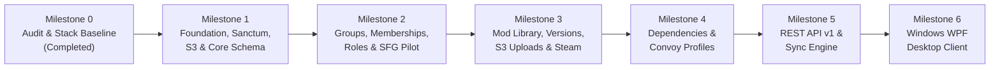

# Ghost ModSync — Development Roadmap (`docs/05-development-roadmap.md`)

**Date:** 2026-11-09  
**Role:** Lead Software Architect  
**Strategy:** Web Backend First (Laravel 13 + Blade + REST API v1), followed by Windows Desktop Client (C# / .NET / WPF).

---

## 1. Phased Implementation Plan

---

## 2. Detailed Milestone Breakdown

### Milestone 0: Project Audit & Runtime Baseline (Completed)
- Inspect existing Laravel Breeze scaffolding.
- Upgrade local XAMPP PHP runtime from `8.2.12` to `8.4.27` (Thread-Safe VS17 x64).
- Upgrade `laravel/framework` to `^13.0` (`v13.40.0`) and `phpunit/phpunit` to `^12.0` (`v12.5.43`).
- Enable `MustVerifyEmail` on [`User`](file:///c:/xampp/htdocs/ghostModSync/app/Models/User.php).
- Standardize database configuration on `ghostModsSync` (MySQL).
- Establish permanent architecture and project rules (`PROJECT_CONTEXT.md`, `docs/01`–`07`, `AGENTS.md` / `GEMINI.md`).

---

### Milestone 1: Foundation, Sanctum, S3 & Core Schema (Completed)
**Goal:** Install missing core packages, harden `AppServiceProvider`, and build the foundational enums, audit logger, and games/devices schema.
- **Tasks:**
  1. Install `laravel/sanctum` (`v4.3.3`) and `league/flysystem-aws-s3-v3` (`v3.35.3`).
  2. Remove leftover `@tailwindcss/vite` from [package.json](file:///c:/xampp/htdocs/ghostModSync/package.json) and remove unused `database/database.sqlite`.
  3. Configure `Model::shouldBeStrict(! $this->app->isProduction())`, `Password::defaults()`, and API/download rate limiters in [`AppServiceProvider`](file:///c:/xampp/htdocs/ghostModSync/app/Providers/AppServiceProvider.php).
  4. Create backed PHP 8.4 Enums in `app/Enums/` (`GameCode`, `GroupVisibility`, `GroupRole`, `MembershipStatus`, `ModSourceType`, `ModVersionStatus`, `DependencyType`, `SyncPolicyMode`, `SyncStatus`).
  5. Create migrations, models, and seeders for `games` (`ets2`, `ats`), `game_versions`, `devices`, and `audit_logs`.
  6. Implement `AuditLoggerService`, `DeviceRegistrationService`, `/api/v1/auth/device-token`, and device management Blade UI (`/devices`).
- **Verification:** Passed automated feature tests in [`DeviceManagementTest`](file:///c:/xampp/htdocs/ghostModSync/tests/Feature/DeviceManagementTest.php).

---

### Milestone 2: Groups, Memberships, Permissions & SFG Pilot (Completed)
**Goal:** Deliver multi-group (multi-VTC) management, public/private visibility, group-scoped roles, invitations, and the **SFG** pilot group.
- **Tasks:**
  1. Create migrations, models, and factories for `groups`, `group_memberships`, and `group_invitations`.
  2. Implement `GroupPermissionService` and `GroupPolicy` enforcing `owner`, `admin`, `mod_manager`, `convoy_dispatcher`, and `member` permissions per group.
  3. Build `SfgPilotSeeder` to provision the **SFG** pilot group with ETS2 and ATS configurations.
  4. Build Blade Web Controllers (`GroupController`), `/api/v1/groups` (`GroupApiController`), and views (`/groups`, `/groups/create`, `/groups/{group}`).
- **Verification:** Passed automated feature tests in [`GroupManagementTest`](file:///c:/xampp/htdocs/ghostModSync/tests/Feature/GroupManagementTest.php) verifying multi-group roles, private group isolation, and invitation tokens.

---

### Milestone 3: Mod Catalogue, Mod Versions, S3 Pre-Signed Uploads & Steam Workshop (Completed)
**Goal:** Enable Mod Managers to maintain group mod libraries backed by S3 object storage (with SHA-256 verification) and Steam Workshop references.
- **Tasks:**
  1. Created migrations, models, and policies for `mods`, `mod_versions`, and `mod_sources` ([2026_11_09_100006_create_mods_and_versions_tables.php](file:///c:/xampp/htdocs/ghostModSync/database/migrations/2026_11_09_100006_create_mods_and_versions_tables.php)).
  2. Implemented [`S3ModStorageService`](file:///c:/xampp/htdocs/ghostModSync/app/Services/Mods/S3ModStorageService.php) for `.scs`/`.zip` filename sanitization, quota enforcement, and pre-signed S3 upload/download URLs.
  3. Implemented [`SteamWorkshopService`](file:///c:/xampp/htdocs/ghostModSync/app/Services/Mods/SteamWorkshopService.php) using `Http::asForm()->post()` against Steam's `GetPublishedFileDetails` API.
  4. Implemented [`ModCatalogueService`](file:///c:/xampp/htdocs/ghostModSync/app/Services/Mods/ModCatalogueService.php) and [`ModController`](file:///c:/xampp/htdocs/ghostModSync/app/Http/Controllers/Web/ModController.php).

---

### Milestone 4: Mod Dependencies & Convoy Profiles (Completed)
**Goal:** Enable Mod Managers and Convoy Dispatchers to define mod dependencies and build version-pinned, ordered Convoy Profiles.
- **Tasks:**
  1. Created migrations, models, and policies for `mod_dependencies`, `convoy_profiles`, and `convoy_profile_mods` ([2026_11_09_100007_create_convoy_profiles_and_sync_tables.php](file:///c:/xampp/htdocs/ghostModSync/database/migrations/2026_11_09_100007_create_convoy_profiles_and_sync_tables.php)).
  2. Implemented [`DependencyResolverService`](file:///c:/xampp/htdocs/ghostModSync/app/Services/Mods/DependencyResolverService.php) with DFS cycle detection and profile dependency/conflict validation.
  3. Implemented [`ConvoyProfileService`](file:///c:/xampp/htdocs/ghostModSync/app/Services/Profiles/ConvoyProfileService.php) with deterministic SHA-256 `manifest_hash` calculation and revision tracking.

---

### Milestone 5: Synchronisation Engine, 20-Table Relational Schema & REST API v1 (`/api/v1/*`) (Completed)
**Goal:** Expose the complete versioned REST API for the Windows desktop application and implement the 20-table relational architecture, immutable convoy profile revisions, DLC requirements, group mod approvals, and synchronisation state machine.
- **Tasks:**
  1. Created migrations and models for `sync_approvals`, `sync_sessions`, `sync_session_items`, `group_join_requests`, `group_mod_approvals`, `game_dlcs`, `mod_version_dlc`, `convoy_profile_revisions`, and `convoy_profile_revision_mods` ([2026_11_09_100008_create_group_join_requests_and_mod_approvals_tables.php](file:///c:/xampp/htdocs/ghostModSync/database/migrations/2026_11_09_100008_create_group_join_requests_and_mod_approvals_tables.php), [2026_11_09_100009_create_game_dlcs_and_mod_version_dlc_tables.php](file:///c:/xampp/htdocs/ghostModSync/database/migrations/2026_11_09_100009_create_game_dlcs_and_mod_version_dlc_tables.php), [2026_11_09_100010_create_convoy_profile_revisions_and_sync_session_items_tables.php](file:///c:/xampp/htdocs/ghostModSync/database/migrations/2026_11_09_100010_create_convoy_profile_revisions_and_sync_session_items_tables.php)).
  2. Implemented [`SyncCoordinatorService`](file:///c:/xampp/htdocs/ghostModSync/app/Services/Sync/SyncCoordinatorService.php) supporting both `automatic` and `approval_required` policies, append-only `sync_sessions` history tied to `convoy_profile_revision_id`, and per-mod `sync_session_items`.
  3. Built [`ConvoySyncApiController`](file:///c:/xampp/htdocs/ghostModSync/app/Http/Controllers/Api/V1/ConvoySyncApiController.php) and [`ConvoyProfileManifestResource`](file:///c:/xampp/htdocs/ghostModSync/app/Http/Resources/V1/ConvoyProfileManifestResource.php) exposing all `/api/v1/*` endpoints.
  4. Verified via automated PHPUnit 12 tests in [`ModAndConvoySyncTest`](file:///c:/xampp/htdocs/ghostModSync/tests/Feature/ModAndConvoySyncTest.php) (37 tests, 188 assertions passing).

---

### Milestone 6: Windows Desktop Application (C# / .NET / WPF)
**Goal:** Build the native Windows client that consumes `/api/v1/*` and synchronises local ETS2/ATS mods.
- **Tasks:**
  1. Scaffold .NET 8+ WPF application with MVVM architecture (`CommunityToolkit.Mvvm`).
  2. Implement Sanctum authentication & Windows DPAPI token storage.
  3. Implement local filesystem scanner for `Documents\Euro Truck Simulator 2\mod`, `Documents\American Truck Simulator\mod`, and Steam Workshop folders with streaming `SHA256` computation.
  4. Implement S3 pre-signed download manager (staging directory, progress bar, SHA-256 verification, atomic move into game `mod/` folder).
  5. Implement Convoy Profile selector and sync status reporting.
