# Ghost ModSync — Complete Entity-Relationship Diagram & SFG Reference Data (`docs/08-database-erd.md`)

**Date:** 2026-11-09  
**Role:** Senior Database Architect  
**Database Name:** `ghostModsSync`

---

## 1. Complete Mermaid Entity-Relationship Diagram (ERD)

```mermaid
erDiagram
    users ||--o{ devices : "registers (CASCADE)"
    users ||--o{ groups : "owns (RESTRICT)"
    users ||--o{ group_memberships : "holds role in (CASCADE)"
    users ||--o{ group_join_requests : "submits (CASCADE)"
    users ||--o{ sync_approvals : "requests (CASCADE)"
    users ||--o{ sync_sessions : "executes (CASCADE)"
    users ||--o{ audit_logs : "triggers (SET NULL)"

    groups ||--o{ group_memberships : "has members (CASCADE)"
    groups ||--o{ group_invitations : "issues (CASCADE)"
    groups ||--o{ group_join_requests : "receives (CASCADE)"
    groups ||--o{ mods : "owns catalogue (CASCADE)"
    groups ||--o{ group_mod_approvals : "vets versions (CASCADE)"
    groups ||--o{ convoy_profiles : "maintains (CASCADE)"
    groups ||--o{ audit_logs : "scopes (SET NULL)"

    games ||--o{ game_versions : "releases (CASCADE)"
    games ||--o{ game_dlcs : "offers DLCs (CASCADE)"
    games ||--o{ mods : "targets (RESTRICT)"
    games ||--o{ convoy_profiles : "targets (RESTRICT)"

    mods ||--o{ mod_versions : "versions (CASCADE)"
    mod_versions ||--|| mod_sources : "backed by 1:1 (CASCADE)"
    mod_versions ||--o{ mod_dependencies : "declares (CASCADE)"
    mods ||--o{ mod_dependencies : "referenced by (CASCADE)"
    mod_versions ||--o{ mod_version_dlc : "requires DLC (CASCADE)"
    game_dlcs ||--o{ mod_version_dlc : "required by (CASCADE)"
    mod_versions ||--o{ group_mod_approvals : "approved in (CASCADE)"

    convoy_profiles ||--o{ convoy_profile_mods : "active load order (CASCADE)"
    convoy_profiles ||--o{ convoy_profile_revisions : "publishes snapshots (CASCADE)"
    convoy_profile_revisions ||--o{ convoy_profile_revision_mods : "pins snapshot mods (CASCADE)"
    mod_versions ||--o{ convoy_profile_mods : "pinned in active (RESTRICT)"
    mod_versions ||--o{ convoy_profile_revision_mods : "pinned in snapshot (RESTRICT)"

    convoy_profiles ||--o{ sync_approvals : "gates sync (CASCADE)"
    convoy_profile_revisions ||--o{ sync_approvals : "approves rev (RESTRICT)"
    convoy_profiles ||--o{ sync_sessions : "tracks (CASCADE)"
    convoy_profile_revisions ||--o{ sync_sessions : "synced against rev (RESTRICT)"
    devices ||--o{ sync_sessions : "reports from (CASCADE)"
    sync_sessions ||--o{ sync_session_items : "logs per-mod outcome (CASCADE)"
    mod_versions ||--o{ sync_session_items : "evaluated in (RESTRICT)"

    users {
        bigint_unsigned id PK
        varchar_255 name
        varchar_50 username UK
        varchar_255 email UK
        varchar_32 steam_id
        timestamp email_verified_at
        boolean is_platform_admin
    }

    devices {
        bigint_unsigned id PK
        bigint_unsigned user_id FK
        bigint_unsigned personal_access_token_id FK
        char_36 device_uuid UK
        varchar_120 device_name
        varchar_500 ets2_mod_path
        varchar_500 ats_mod_path
        timestamp revoked_at
    }

    groups {
        bigint_unsigned id PK
        bigint_unsigned owner_id FK
        varchar_120 name
        varchar_120 slug UK
        varchar_16 tag
        varchar_20 visibility
        varchar_30 sync_policy
        boolean require_join_approval
        boolean require_mod_approval
        bigint_unsigned storage_quota_bytes
        timestamp deleted_at
    }

    group_memberships {
        bigint_unsigned id PK
        bigint_unsigned group_id FK
        bigint_unsigned user_id FK
        varchar_30 role
        varchar_20 status
        timestamp joined_at
    }

    group_join_requests {
        bigint_unsigned id PK
        bigint_unsigned group_id FK
        bigint_unsigned user_id FK
        text message
        varchar_20 status
        bigint_unsigned reviewed_by FK
        timestamp reviewed_at
    }

    games {
        bigint_unsigned id PK
        varchar_16 code UK
        varchar_100 name
        int_unsigned steam_app_id UK
        varchar_100 default_mod_dir_name
    }

    game_versions {
        bigint_unsigned id PK
        bigint_unsigned game_id FK
        varchar_32 version_branch
        boolean is_current
    }

    game_dlcs {
        bigint_unsigned id PK
        bigint_unsigned game_id FK
        varchar_50 code
        varchar_120 name
        int_unsigned steam_app_id UK
        varchar_30 category
    }

    mods {
        bigint_unsigned id PK
        bigint_unsigned group_id FK
        bigint_unsigned game_id FK
        varchar_150 name
        varchar_160 slug
        varchar_50 category
        varchar_30 source_type
        timestamp deleted_at
    }

    mod_versions {
        bigint_unsigned id PK
        bigint_unsigned mod_id FK
        varchar_50 version_number
        varchar_255 archive_filename
        bigint_unsigned file_size_bytes
        char_64 sha256_hash
        varchar_20 status
        timestamp published_at
    }

    mod_sources {
        bigint_unsigned id PK
        bigint_unsigned mod_version_id FK
        varchar_30 source_type
        varchar_500 s3_object_key
        varchar_32 steam_published_file_id
    }

    mod_version_dlc {
        bigint_unsigned id PK
        bigint_unsigned mod_version_id FK
        bigint_unsigned game_dlc_id FK
        boolean is_required
    }

    mod_dependencies {
        bigint_unsigned id PK
        bigint_unsigned mod_version_id FK
        bigint_unsigned related_mod_id FK
        bigint_unsigned related_mod_version_id FK
        varchar_20 dependency_type
    }

    group_mod_approvals {
        bigint_unsigned id PK
        bigint_unsigned group_id FK
        bigint_unsigned mod_version_id FK
        varchar_20 status
        boolean checksum_verified
        bigint_unsigned reviewed_by FK
        timestamp approved_at
    }

    convoy_profiles {
        bigint_unsigned id PK
        bigint_unsigned group_id FK
        bigint_unsigned game_id FK
        bigint_unsigned current_revision_id FK
        varchar_150 name
        varchar_160 slug
        varchar_32 target_game_version
        int_unsigned revision
        char_64 manifest_hash
        boolean is_default
    }

    convoy_profile_revisions {
        bigint_unsigned id PK
        bigint_unsigned convoy_profile_id FK
        int_unsigned revision_number
        bigint_unsigned published_by FK
        varchar_32 target_game_version
        char_64 manifest_hash
        json snapshot_json
        timestamp published_at
    }

    convoy_profile_revision_mods {
        bigint_unsigned id PK
        bigint_unsigned convoy_profile_revision_id FK
        bigint_unsigned mod_version_id FK
        int_unsigned load_order
        boolean is_required
    }

    sync_sessions {
        bigint_unsigned id PK
        bigint_unsigned convoy_profile_id FK
        bigint_unsigned convoy_profile_revision_id FK
        bigint_unsigned user_id FK
        bigint_unsigned device_id FK
        int_unsigned profile_revision
        char_64 reported_manifest_hash
        varchar_25 status
        bigint_unsigned bytes_downloaded
        timestamp synced_at
    }

    sync_session_items {
        bigint_unsigned id PK
        bigint_unsigned sync_session_id FK
        bigint_unsigned mod_version_id FK
        varchar_30 action_taken
        varchar_25 status
        char_64 local_sha256_hash
        bigint_unsigned bytes_downloaded
    }
```



---

## 2. Deletion & Archival Strategy

| Entity | Deletion Strategy | Foreign Key Action on Child Tables | Rationale |
| :--- | :--- | :--- | :--- |
| `users` | Hard delete allowed only if not owning an active `Group` (`groups.owner_id` is `RESTRICT`) | `devices` (`CASCADE`), `group_memberships` (`CASCADE`), `audit_logs` (`SET NULL`), `convoy_profile_revisions.published_by` (`SET NULL`) | Preserves group continuity and historical audit/revision authorship records even if a staff member leaves. |
| `groups` | `SoftDeletes` (`deleted_at`) | If force-deleted: `CASCADE` on `mods`, `convoy_profiles`, `group_memberships`; `SET NULL` on `audit_logs`. | Prevents accidental loss of VTC mod libraries and convoy history. |
| `mods` | `SoftDeletes` (`deleted_at`) | `mod_versions` (`CASCADE` on force delete). | Allows archiving obsolete mods while keeping them visible in past convoy revisions. |
| `mod_versions` | `SoftDeletes` (`deleted_at`) | `convoy_profile_revision_mods` (`RESTRICT`), `sync_session_items` (`RESTRICT`). | A `ModVersion` that was part of any published convoy revision or sync session can never be hard-deleted, guaranteeing historical reproducibility. |
| `convoy_profiles` | `SoftDeletes` (`deleted_at`) | `convoy_profile_revisions` (`CASCADE` on force delete). | Allows retiring seasonal convoy profiles cleanly. |
| `convoy_profile_revisions` | **Immutable (Never Deleted)** | `sync_sessions` (`RESTRICT`), `convoy_profile_revision_mods` (`CASCADE`). | Published snapshots are permanent audit artifacts. |

---

## 3. Concrete Example Records Demonstrating SFG Pilot Usage

### 3.1 `groups` (SFG Pilot VTC)
```json
{
  "id": 1,
  "owner_id": 1,
  "name": "SFG",
  "slug": "sfg",
  "tag": "[SFG]",
  "description": "Initial Pilot Virtual Trucking Company (SFG) for ETS2 and ATS convoy mod synchronisation.",
  "visibility": "public",
  "sync_policy": "automatic",
  "require_join_approval": true,
  "require_mod_approval": true,
  "storage_quota_bytes": 107374182400
}
```

### 3.2 `group_memberships` (Multi-Role Example in SFG)
```json
[
  { "id": 1, "group_id": 1, "user_id": 1, "role": "owner", "status": "active", "joined_at": "2026-11-09T10:00:00Z" },
  { "id": 2, "group_id": 1, "user_id": 2, "role": "mod_manager", "status": "active", "joined_at": "2026-11-09T10:05:00Z" },
  { "id": 3, "group_id": 1, "user_id": 3, "role": "convoy_dispatcher", "status": "active", "joined_at": "2026-11-09T10:10:00Z" },
  { "id": 4, "group_id": 1, "user_id": 4, "role": "member", "status": "active", "joined_at": "2026-11-09T10:15:00Z" }
]
```

### 3.3 `mods`, `mod_versions`, `mod_sources`, `mod_version_dlc`, & `group_mod_approvals`
```json
{
  "mod": {
    "id": 10,
    "group_id": 1,
    "game_id": 1,
    "name": "SFG Heavy Haul Fleet Pack",
    "slug": "sfg-heavy-haul-fleet-pack",
    "category": "skin",
    "source_type": "s3_upload"
  },
  "mod_version": {
    "id": 25,
    "mod_id": 10,
    "version_number": "1.4.2",
    "min_game_version": "1.53",
    "max_game_version": "1.53",
    "archive_filename": "sfg_heavy_haul_v1_4_2.scs",
    "file_size_bytes": 68157440,
    "sha256_hash": "9f86d081884c7d659a2feaa0c55ad015a3bf4f1b2b0b822cd15d6c15b0f00a08",
    "status": "ready"
  },
  "mod_source": {
    "id": 25,
    "mod_version_id": 25,
    "source_type": "s3_upload",
    "s3_disk": "s3",
    "s3_object_key": "groups/1/games/ets2/mods/10/versions/1-4-2-a8f3b2c1/sfg_heavy_haul_v1_4_2.scs"
  },
  "required_dlcs": [
    { "game_dlc_id": 4, "code": "dlc_heavy_cargo", "name": "Heavy Cargo Pack", "steam_app_id": 531131 }
  ],
  "group_mod_approval": {
    "group_id": 1,
    "mod_version_id": 25,
    "status": "approved",
    "checksum_verified": true,
    "reviewed_by": 2,
    "review_notes": "Verified SHA-256 and tested on ETS2 1.53 dedicated server with 0 gamelog errors.",
    "approved_at": "2026-11-09T10:20:00Z"
  }
}
```

### 3.4 `convoy_profiles`, `convoy_profile_revisions`, & `convoy_profile_revision_mods`
```json
{
  "convoy_profile": {
    "id": 5,
    "group_id": 1,
    "game_id": 1,
    "current_revision_id": 12,
    "name": "SFG Weekly Euro Convoy",
    "slug": "sfg-weekly-euro-convoy",
    "target_game_version": "1.53",
    "revision": 2,
    "manifest_hash": "3c7b9e2a4d5f8a1e6c0b2d4f8a9c1e3b5d7f9a0c2e4b6d8f0a1c3e5b7d9f1a2c",
    "is_default": true
  },
  "convoy_profile_revision": {
    "id": 12,
    "convoy_profile_id": 5,
    "revision_number": 2,
    "published_by": 3,
    "target_game_version": "1.53",
    "manifest_hash": "3c7b9e2a4d5f8a1e6c0b2d4f8a9c1e3b5d7f9a0c2e4b6d8f0a1c3e5b7d9f1a2c",
    "changelog": "Upgraded SFG Heavy Haul Fleet Pack to v1.4.2 and pinned SiSL Mega Pack Workshop item.",
    "published_at": "2026-11-09T10:25:00Z"
  },
  "convoy_profile_revision_mods": [
    {
      "convoy_profile_revision_id": 12,
      "load_order": 1,
      "mod_version_id": 25,
      "is_required": true,
      "notes": "Top priority — SFG VTC skins"
    },
    {
      "convoy_profile_revision_id": 12,
      "load_order": 2,
      "mod_version_id": 26,
      "is_required": true,
      "notes": "Steam Workshop interior accessories"
    }
  ]
}
```

### 3.5 `sync_sessions` & `sync_session_items`
```json
{
  "sync_session": {
    "id": 88,
    "convoy_profile_id": 5,
    "convoy_profile_revision_id": 12,
    "user_id": 4,
    "device_id": 9,
    "profile_revision": 2,
    "reported_manifest_hash": "3c7b9e2a4d5f8a1e6c0b2d4f8a9c1e3b5d7f9a0c2e4b6d8f0a1c3e5b7d9f1a2c",
    "status": "in_sync",
    "missing_mods_count": 0,
    "mismatched_mods_count": 0,
    "extra_local_mods_count": 0,
    "bytes_downloaded": 68157440,
    "duration_ms": 4820,
    "synced_at": "2026-11-09T10:30:00Z"
  },
  "sync_session_items": [
    {
      "sync_session_id": 88,
      "mod_version_id": 25,
      "action_taken": "downloaded_s3",
      "status": "in_sync",
      "local_sha256_hash": "9f86d081884c7d659a2feaa0c55ad015a3bf4f1b2b0b822cd15d6c15b0f00a08",
      "bytes_downloaded": 68157440
    },
    {
      "sync_session_id": 88,
      "mod_version_id": 26,
      "action_taken": "verified_workshop",
      "status": "in_sync",
      "local_sha256_hash": null,
      "bytes_downloaded": 0
    }
  ]
}
```
