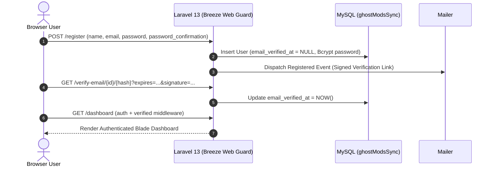
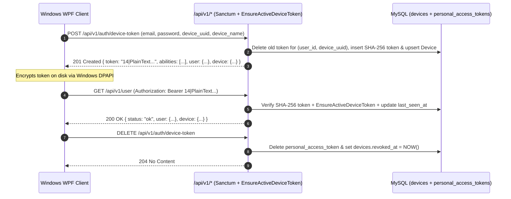

# Ghost ModSync — Authentication & API Foundation (`docs/09-authentication-and-api.md`)

**Date:** 2026-11-09  
**Role:** Senior Laravel Security Engineer  
**Stack:** Laravel `v13.40.0`, Laravel Breeze `v2.4.2`, Laravel Sanctum `v4.3.3`

---

## 1. Dual Authentication Architecture Overview

Ghost ModSync separates **browser authentication** and **Windows desktop API authentication** into two distinct security models tailored to their respective clients:

| Dimension | Web Portal (Browser) | Windows Desktop Client (C# / .NET / WPF) |
| :--- | :--- | :--- |
| **Authentication Guard** | `web` (Stateful Session Cookie) | `sanctum` (Bearer Personal Access Token) |
| **Implementation** | Laravel Breeze (`App\Http\Controllers\Auth\*`) | Laravel Sanctum (`App\Http\Controllers\Api\V1\DeviceAuthController`) |
| **CSRF Protection** | Mandatory (`VerifyCsrfToken` middleware) | Stateless `Authorization: Bearer <id>|<secret>` header |
| **Token Storage (Server)** | `sessions` table (`http_only`, `same_site=lax`) | `personal_access_tokens` table (64-char SHA-256 hex digest only; plaintext never stored) |
| **Token Storage (Client)** | Encrypted HTTP-only browser cookie | Windows DPAPI (`ProtectedData.Protect` with `DataProtectionScope.CurrentUser`) |
| **Device Association** | Browser session (`ip_address`, `user_agent`) | 1:1 bound to `devices` (`device_uuid`, `personal_access_token_id`, `revoked_at`) |
| **Email Verification** | Required (`verified` middleware via `MustVerifyEmail`) | Required (`hasVerifiedEmail()` check on issuance + `verified` middleware on `/api/v1/*`) |

---

## 2. Browser Authentication Flow (Laravel Breeze)

### 2.1 Preserved Breeze Endpoints & Controllers
All existing Laravel Breeze routes in [routes/auth.php](file:///c:/xampp/htdocs/ghostModSync/routes/auth.php) and [routes/web.php](file:///c:/xampp/htdocs/ghostModSync/routes/web.php) are preserved intact:
- **Registration:** `GET /register` & `POST /register` ([`RegisteredUserController`](file:///c:/xampp/htdocs/ghostModSync/app/Http/Controllers/Auth/RegisteredUserController.php)) — validates password complexity via `Password::defaults()` (min 10 chars, mixed case, numbers, symbols in production), hashes with Bcrypt (`12` rounds), dispatches `Registered` event (sending verification email), and logs the user in.
- **Login & Logout:** `GET /login`, `POST /login`, `POST /logout` ([`AuthenticatedSessionController`](file:///c:/xampp/htdocs/ghostModSync/app/Http/Controllers/Auth/AuthenticatedSessionController.php)) — rate-limited (`5` attempts per email+IP via [`LoginRequest`](file:///c:/xampp/htdocs/ghostModSync/app/Http/Requests/Auth/LoginRequest.php)), regenerates session ID on login to prevent session fixation, records `last_login_at`, and invalidates session + CSRF token on logout.
- **Password Reset:** `GET /forgot-password`, `POST /forgot-password`, `GET /reset-password/{token}`, `POST /reset-password` ([`PasswordResetLinkController`](file:///c:/xampp/htdocs/ghostModSync/app/Http/Controllers/Auth/PasswordResetLinkController.php), [`NewPasswordController`](file:///c:/xampp/htdocs/ghostModSync/app/Http/Controllers/Auth/NewPasswordController.php)).
- **Email Verification:** `GET /verify-email`, `GET /verify-email/{id}/{hash}`, `POST /email/verification-notification` ([`VerifyEmailController`](file:///c:/xampp/htdocs/ghostModSync/app/Http/Controllers/Auth/VerifyEmailController.php)) — enforced on [`User`](file:///c:/xampp/htdocs/ghostModSync/app/Models/User.php) via `implements MustVerifyEmail`.
- **Authenticated Profile Management:** `GET /profile`, `PATCH /profile`, `DELETE /profile` ([`ProfileController`](file:///c:/xampp/htdocs/ghostModSync/app/Http/Controllers/ProfileController.php) & [`ProfileUpdateRequest`](file:///c:/xampp/htdocs/ghostModSync/app/Http/Requests/ProfileUpdateRequest.php)) — supports updating `name`, `username`, `steam_id`, and `email` (resetting `email_verified_at` if email changes). `is_platform_admin` is excluded from `$fillable` and hidden in `$hidden` to prevent privilege escalation via mass assignment.



---

## 3. Windows Desktop Client Authentication Flow (Laravel Sanctum)

### 3.1 Token Issuance, Device Binding & Rotation
1. The Windows WPF client generates a persistent machine/installation `device_uuid` (UUID v4) and prompts the user for their email and password.
2. The client sends `POST /api/v1/auth/device-token` (rate-limited to `6` requests/minute per IP).
3. [`DeviceAuthController::store()`](file:///c:/xampp/htdocs/ghostModSync/app/Http/Controllers/Api/V1/DeviceAuthController.php#L27-L63) verifies credentials and confirms `$user->hasVerifiedEmail()`.
4. [`DeviceRegistrationService::registerAndIssueToken()`](file:///c:/xampp/htdocs/ghostModSync/app/Services/Devices/DeviceRegistrationService.php#L40-L97) runs inside a database transaction:
   - If the `(user_id, device_uuid)` pair already had an older Sanctum token, the previous token row in `personal_access_tokens` is immediately deleted (preventing orphaned tokens).
   - Issues a new Sanctum Personal Access Token with explicit abilities:
     - `groups:read`
     - `profiles:read`
     - `mods:download`
     - `sync:report`
   - Sanctum stores **only** `hash('sha256', $rawSecret)` in `personal_access_tokens.token`.
   - Upserts the `devices` record with `personal_access_token_id = $token->id`, `revoked_at = null`, `last_seen_at = now()`, and `last_ip_address`, and writes an immutable `device.authenticated` entry to `audit_logs`.

### 3.2 Request Verification & Revocation Middleware (`EnsureActiveDeviceToken`)
Every protected `/api/v1/*` route runs through:
`['auth:sanctum', 'active.device', 'verified', 'throttle:api']`
- [`EnsureActiveDeviceToken`](file:///c:/xampp/htdocs/ghostModSync/app/Http/Middleware/EnsureActiveDeviceToken.php) checks the `Device` bound to the current `PersonalAccessToken`. If an administrator or user has marked `revoked_at` on the `Device`, the token is immediately deleted and a `401 Unauthorized` (`error_code: "device_revoked"`) JSON response is returned.
- Route groups additionally enforce granular Sanctum abilities (`ability:groups:read`, `ability:profiles:read`, `ability:mods:download`, `ability:sync:report`).



---

## 4. Versioned API Response & Error Structure (`/api/v1/*`)

Configured in [bootstrap/app.php](file:///c:/xampp/htdocs/ghostModSync/bootstrap/app.php), all `/api/v1/*` endpoints return structured JSON responses with consistent HTTP status codes and machine-readable `error_code` fields.

### 4.1 Example 1: Issue Desktop Device Token (`POST /api/v1/auth/device-token`)
**Request:**
```http
POST /api/v1/auth/device-token HTTP/1.1
Host: localhost
Accept: application/json
Content-Type: application/json

{
  "email": "driver@sfg-vtc.test",
  "password": "SecretTrucker123!",
  "device_uuid": "7c9e6679-7425-40de-944b-e07fc1f90ae7",
  "device_name": "DESKTOP-SFG-01",
  "os_version": "Windows 11 Pro 23H2",
  "client_version": "1.0.0",
  "ets2_mod_path": "C:\\Users\\Driver\\Documents\\Euro Truck Simulator 2\\mod"
}
```

**Success Response (`201 Created`):**
```json
{
  "status": "ok",
  "token": "1|9xK8vL2mN4pQ6rS8tU0vW2xY4zA6bC8dE0fG2hI4",
  "abilities": [
    "groups:read",
    "profiles:read",
    "mods:download",
    "sync:report"
  ],
  "user": {
    "id": 4,
    "name": "SFG Driver",
    "username": "sfg_driver",
    "email": "driver@sfg-vtc.test",
    "steam_id": "76561198012345678",
    "email_verified": true,
    "email_verified_at": "2026-11-09T10:00:00Z",
    "created_at": "2026-11-09T09:55:00Z"
  },
  "device": {
    "id": 1,
    "device_uuid": "7c9e6679-7425-40de-944b-e07fc1f90ae7",
    "device_name": "DESKTOP-SFG-01",
    "os_version": "Windows 11 Pro 23H2",
    "client_version": "1.0.0",
    "ets2_mod_path": "C:\\Users\\Driver\\Documents\\Euro Truck Simulator 2\\mod",
    "ats_mod_path": null,
    "last_seen_at": "2026-11-09T10:05:00Z",
    "is_revoked": false
  }
}
```

### 4.2 Example 2: Validation Error (`422 Unprocessable Entity`)
```json
{
  "status": "error",
  "error_code": "validation_failed",
  "message": "The email field must be a valid email address. (and 3 more errors)",
  "errors": {
    "email": ["The email field must be a valid email address."],
    "password": ["The password field is required."],
    "device_uuid": ["The device uuid field is required."],
    "device_name": ["The device name field is required."]
  }
}
```

### 4.3 Example 3: Authentication Error (`401 Unauthorized`)
```json
{
  "status": "error",
  "error_code": "unauthenticated",
  "message": "Unauthenticated."
}
```

### 4.4 Example 4: Authorization / Missing Ability Error (`403 Forbidden`)
```json
{
  "status": "error",
  "error_code": "insufficient_token_abilities",
  "message": "The current API token does not have the required ability for this action."
}
```

### 4.5 Example 5: Resource Not Found (`404 Not Found`)
```json
{
  "status": "error",
  "error_code": "not_found",
  "message": "The requested resource was not found."
}
```

### 4.6 Example 6: Rate Limit Exceeded (`429 Too Many Requests`)
```json
{
  "status": "error",
  "error_code": "rate_limit_exceeded",
  "message": "Too many requests. Please slow down."
}
```
