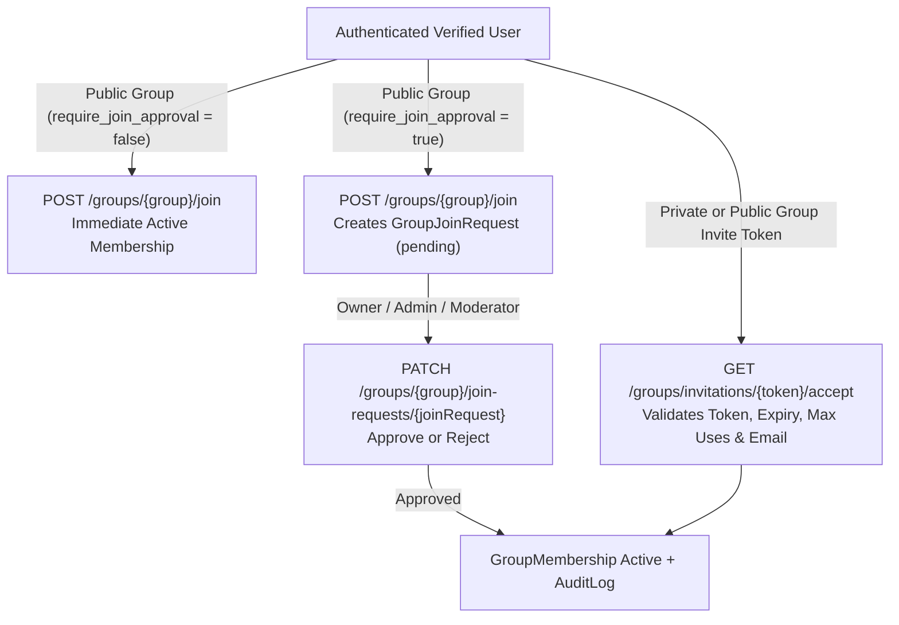

# Ghost ModSync — Group Management & Membership Module (`docs/10-group-management.md`)

**Date:** 2026-11-09  
**Role:** Senior Laravel Software Engineer (Multi-Tenant Architecture)  
**Status:** Implemented & Verified

---

## 1. Module Architecture Overview

The **Group Management & Membership Module** provides strict multi-tenant VTC and community governance for Ghost ModSync. Every user can belong to multiple groups (`groups`) simultaneously and hold an independent role (`group_memberships.role`) in each group.

### Core Components
- **Models (`app/Models/`):**
  - [`Group`](file:///c:/xampp/htdocs/ghostModSync/app/Models/Group.php) — VTC/community entity (`SoftDeletes`), owned by `owner_id`, configured with `visibility` (`public`/`private`), `sync_policy` (`automatic`/`approval_required`), `require_join_approval`, `require_mod_approval`, and branding metadata (`tag`, `description`, `logo_path`, `banner_path`).
  - [`GroupMembership`](file:///c:/xampp/htdocs/ghostModSync/app/Models/GroupMembership.php) — Pivot entity linking `User` and `Group` (`UNIQUE (group_id, user_id)`), storing `role` ([`GroupRole`](file:///c:/xampp/htdocs/ghostModSync/app/Enums/GroupRole.php)) and `status` ([`MembershipStatus`](file:///c:/xampp/htdocs/ghostModSync/app/Enums/MembershipStatus.php)).
  - [`GroupJoinRequest`](file:///c:/xampp/htdocs/ghostModSync/app/Models/GroupJoinRequest.php) — Inbound applications (`pending`, `approved`, `rejected`, `cancelled`) for approval-gated public groups.
  - [`GroupInvitation`](file:///c:/xampp/htdocs/ghostModSync/app/Models/GroupInvitation.php) — Cryptographic 64-char hex invite tokens with optional target email, role grant, usage limit (`max_uses` vs `uses_count`), `expires_at`, and `revoked_at`.
- **Services (`app/Services/`):**
  - [`GroupPermissionService`](file:///c:/xampp/htdocs/ghostModSync/app/Services/Permissions/GroupPermissionService.php) — Evaluates group-scoped permissions and role hierarchy ranks.
  - [`GroupManagementService`](file:///c:/xampp/htdocs/ghostModSync/app/Services/Groups/GroupManagementService.php) — Executes transactional group creation, updates, archival (`SoftDeletes`), ownership transfers, join request reviews, member role/status updates, member removal, and invitation lifecycle with full `audit_logs` recording.
- **Policy (`app/Policies/`):**
  - [`GroupPolicy`](file:///c:/xampp/htdocs/ghostModSync/app/Policies/GroupPolicy.php) — Server-side authorization gate for `view`, `create`, `update`, `delete`, `transferOwnership`, `manageMembers`, `assignRoles`, `manageMods`, `manageConvoyProfiles`, and `approveSync`.

---

## 2. Group-Scoped Role Hierarchy & Permissions Matrix

Permissions are strictly evaluated against the authenticated user's **active** membership in the target `Group`. Being an `Owner` or `Admin` in Group A grants zero privileges in Group B.

| Operation / Capability | Owner (`rank: 100`) | Administrator (`rank: 80`) | Moderator (`rank: 60`) | Mod Manager (`rank: 50`) | Convoy Dispatcher (`rank: 40`) | Member (`rank: 10`) |
| :--- | :---: | :---: | :---: | :---: | :---: | :---: |
| **View Group & Profiles** | Yes | Yes | Yes | Yes | Yes | Yes |
| **Update Group Settings & Branding** | Yes | Yes | No | No | No | No |
| **Approve / Reject Join Requests** | Yes | Yes | Yes | No | No | No |
| **Create & Revoke Invitations** | Yes | Yes | Yes | No | No | No |
| **Suspend / Restore / Remove Lower-Rank Members** | Yes | Yes (below Admin) | Yes (below Moderator) | No | No | No |
| **Assign / Change Member Roles** | Yes | Yes (below Admin) | No | No | No | No |
| **Manage Mod Library & Versions** | Yes | Yes | No | Yes | No | No |
| **Manage Convoy Profiles** | Yes | Yes | No | Yes | Yes | No |
| **Approve Sync Requests** | Yes | Yes | Yes | No | Yes | No |
| **Transfer Group Ownership** | **Yes** | No | No | No | No | No |
| **Archive / Delete Group** | **Yes** | No | No | No | No | No |

---

## 3. Key Workflows

---

## 4. Routes, Controllers & Blade Views

### Web Routes ([routes/web.php](file:///c:/xampp/htdocs/ghostModSync/routes/web.php)) & [`GroupController`](file:///c:/xampp/htdocs/ghostModSync/app/Http/Controllers/Web/GroupController.php)
All nested `/groups/{group}/*` routes use `Route::scopeBindings()` to prevent cross-group ID manipulation (`404 Not Found` if a child model belongs to a different group):
- `GET /groups` (`groups.index`) -> [resources/views/groups/index.blade.php](file:///c:/xampp/htdocs/ghostModSync/resources/views/groups/index.blade.php) (My Groups + Public VTC Discovery & Search)
- `GET /groups/create` (`groups.create`) & `POST /groups` (`groups.store`) -> [resources/views/groups/create.blade.php](file:///c:/xampp/htdocs/ghostModSync/resources/views/groups/create.blade.php)
- `GET /groups/{group}` (`groups.show`) -> [resources/views/groups/show.blade.php](file:///c:/xampp/htdocs/ghostModSync/resources/views/groups/show.blade.php) (Group Details Overview)
- `GET /groups/{group}/members` (`groups.members`) -> [resources/views/groups/members.blade.php](file:///c:/xampp/htdocs/ghostModSync/resources/views/groups/members.blade.php)
- `GET /groups/{group}/join-requests` (`groups.join-requests`) -> [resources/views/groups/join-requests.blade.php](file:///c:/xampp/htdocs/ghostModSync/resources/views/groups/join-requests.blade.php)
- `GET /groups/{group}/invitations` (`groups.invitations`) -> [resources/views/groups/invitations.blade.php](file:///c:/xampp/htdocs/ghostModSync/resources/views/groups/invitations.blade.php)
- `GET /groups/{group}/settings` (`groups.settings`) -> [resources/views/groups/settings.blade.php](file:///c:/xampp/htdocs/ghostModSync/resources/views/groups/settings.blade.php)
- `PATCH /groups/{group}` (`groups.update`)
- `DELETE /groups/{group}` (`groups.destroy`)
- `POST /groups/{group}/transfer-ownership` (`groups.transfer-ownership`)
- `POST /groups/{group}/join` (`groups.join`)
- `PATCH /groups/{group}/join-requests/{joinRequest}` (`groups.join-requests.review`)
- `PATCH /groups/{group}/memberships/{membership}` (`groups.memberships.update`)
- `DELETE /groups/{group}/memberships/{membership}` (`groups.memberships.destroy`)
- `POST /groups/{group}/invitations` (`groups.invitations.store`)
- `DELETE /groups/{group}/invitations/{invitation}` (`groups.invitations.destroy`)
- `GET /groups/invitations/{token}/accept` (`groups.invitations.accept`)

### API v1 Routes ([routes/api.php](file:///c:/xampp/htdocs/ghostModSync/routes/api.php)) & [`GroupApiController`](file:///c:/xampp/htdocs/ghostModSync/app/Http/Controllers/Api/V1/GroupApiController.php)
- `GET /api/v1/groups` — Lists user's active groups + discoverable public groups (`ability:groups:read`).
- `GET /api/v1/groups/{group}` — Returns group details and caller's `my_role` (`GroupPolicy::view`).

---

## 5. Automated Testing ([tests/Feature/GroupManagementTest.php](file:///c:/xampp/htdocs/ghostModSync/tests/Feature/GroupManagementTest.php))

- **`test_sfg_pilot_seeder_provisions_sfg_group_and_owner`**: Verifies **SFG** pilot VTC provisioning.
- **`test_user_can_belong_to_multiple_groups_with_different_roles`**: Verifies a user can be `Owner` in Group A and `ModManager` in Group B with isolated permissions.
- **`test_private_group_is_isolated_from_non_members_on_web_and_api`**: Verifies `403 Forbidden` for non-members on both Web and `/api/v1/groups/{group}`.
- **`test_private_group_can_be_joined_via_valid_invitation_token`**: Verifies cryptographic invite token creation and redemption.
- **`test_role_hierarchy_suspend_restore_remove_transfer_ownership_and_archive_group`**: Verifies join request submission, `Moderator` approval, member suspension/restoration, rank protection (Moderator cannot suspend Admin or edit settings; Admin cannot transfer ownership or delete group), `Owner` ownership transfer, member removal, and soft-delete archival.
- **`test_cross_group_manipulated_ids_are_blocked`**: Verifies that passing Group B's `membership` ID into Group A's URL (`/groups/{groupA}/memberships/{membershipB}`) is blocked with `404 Not Found`.
