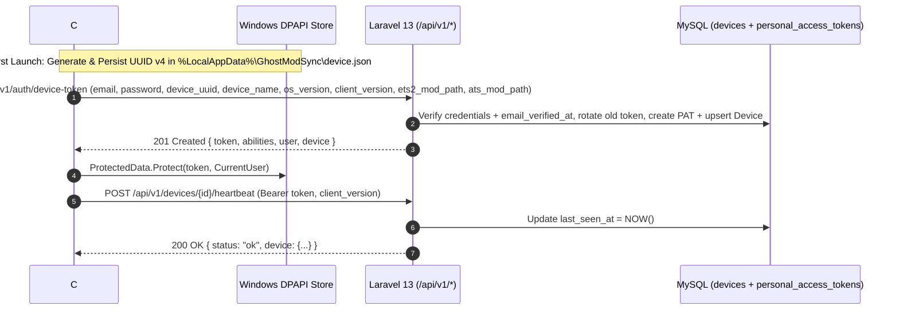

# Ghost ModSync — User Device Management (`docs/11-device-management.md`)

**Date:** 2026-11-09  
**Role:** Senior Backend Engineer  
**Status:** Implemented & Verified

---

## 1. Overview & Architectural Purpose

In Ghost ModSync, a **Device** ([`App\Models\Device`](file:///c:/xampp/htdocs/ghostModSync/app/Models/Device.php)) represents a physical or virtual Windows PC running the Ghost ModSync C#/.NET WPF desktop application. Users may register multiple Windows computers (for example, a primary home sim-rig PC and a laptop) under a single Ghost ModSync account.

### Security Principles
1. **Never Trust `device_uuid` as Proof of Identity:** A `device_uuid` is an installation identifier, **never** an authentication credential. Every device endpoint requires a valid Laravel Sanctum Bearer token (`auth:sanctum`) and an email-verified user (`verified`).
2. **1:1 Token-to-Device Binding:** Each desktop device's Sanctum `PersonalAccessToken` is explicitly linked via `devices.personal_access_token_id`. When a request arrives with a device-bound token, [`EnsureActiveDeviceToken`](file:///c:/xampp/htdocs/ghostModSync/app/Http/Middleware/EnsureActiveDeviceToken.php) resolves the bound `Device` and [`ConvoySyncApiController`](file:///c:/xampp/htdocs/ghostModSync/app/Http/Controllers/Api/V1/ConvoySyncApiController.php) rejects any attempt to spoof a different `device_uuid`.
3. **Strict Per-User Isolation:** [`DevicePolicy`](file:///c:/xampp/htdocs/ghostModSync/app/Policies/DevicePolicy.php) enforces `$user->id === $device->user_id || $user->is_platform_admin` on viewing, updating, heartbeating, revoking, and removing devices.
4. **Immediate Credential Revocation:** Revoking or removing a device via [`DeviceRegistrationService`](file:///c:/xampp/htdocs/ghostModSync/app/Services/Devices/DeviceRegistrationService.php) immediately deletes its `PersonalAccessToken` row inside a database transaction and writes an immutable security event (`device.authenticated`, `device.registered`, `device.updated`, `device.revoked`, `device.removed`) to `audit_logs`.

---

## 2. How the Future C# / .NET WPF Client Registers & Communicates Identity

### C# Client Identity Lifecycle
1. **Installation UUID (`device_uuid`):** On first startup, the WPF client checks `%LocalAppData%\GhostModSync\config.json` for a `DeviceUuid`. If absent, it generates `Guid.NewGuid().ToString("D")` and persists it.
2. **Environment Discovery:** The WPF client reads:
   - `Environment.MachineName` -> `device_name` (user-editable in client settings)
   - `RuntimeInformation.OSDescription` -> `os_version`
   - Assembly version -> `client_version`
   - Detected `Documents\Euro Truck Simulator 2\mod` and `Documents\American Truck Simulator\mod` directories -> `ets2_mod_path`, `ats_mod_path`
3. **Token Storage:** The returned `plain_text_token` is encrypted at rest using `System.Security.Cryptography.ProtectedData.Protect(..., DataProtectionScope.CurrentUser)` so no plaintext token ever sits on the user's disk.
4. **Authenticated API Requests:** Every subsequent `HttpClient` call sends `Authorization: Bearer <token>`. [`EnsureActiveDeviceToken`](file:///c:/xampp/htdocs/ghostModSync/app/Http/Middleware/EnsureActiveDeviceToken.php) automatically verifies the device is not revoked and refreshes `last_seen_at`.

---

## 3. Versioned Device API Endpoints (`/api/v1/*`)

| Method & Endpoint | Controller Action | Purpose |
| :--- | :--- | :--- |
| `POST /api/v1/auth/device-token` | [`DeviceAuthController::store`](file:///c:/xampp/htdocs/ghostModSync/app/Http/Controllers/Api/V1/DeviceAuthController.php#L29-L65) | Authenticate with email/password, register/refresh device, and issue a device-bound Sanctum token (`201 Created`). |
| `DELETE /api/v1/auth/device-token` | [`DeviceAuthController::destroy`](file:///c:/xampp/htdocs/ghostModSync/app/Http/Controllers/Api/V1/DeviceAuthController.php#L168-L189) | Revoke the current device's token on desktop logout (`204 No Content`). |
| `GET /api/v1/devices` | [`DeviceAuthController::indexDevices`](file:///c:/xampp/htdocs/ghostModSync/app/Http/Controllers/Api/V1/DeviceAuthController.php#L92-L102) | List all devices registered to the authenticated user (`200 OK`). |
| `POST /api/v1/devices` | [`DeviceAuthController::storeDevice`](file:///c:/xampp/htdocs/ghostModSync/app/Http/Controllers/Api/V1/DeviceAuthController.php#L70-L87) | Register or bind a device for an already-authenticated user (`201 Created`). |
| `GET /api/v1/devices/{device}` | [`DeviceAuthController::showDevice`](file:///c:/xampp/htdocs/ghostModSync/app/Http/Controllers/Api/V1/DeviceAuthController.php#L107-L115) | View details of a specific device (`200 OK`). |
| `PATCH /api/v1/devices/{device}` | [`DeviceAuthController::updateDevice`](file:///c:/xampp/htdocs/ghostModSync/app/Http/Controllers/Api/V1/DeviceAuthController.php#L120-L132) | Update `device_name`, `os_version`, `client_version`, `ets2_mod_path`, or `ats_mod_path` (`200 OK`). |
| `POST /api/v1/devices/{device}/heartbeat` | [`DeviceAuthController::heartbeat`](file:///c:/xampp/htdocs/ghostModSync/app/Http/Controllers/Api/V1/DeviceAuthController.php#L137-L154) | Update `last_seen_at` and runtime version info (`200 OK`). |
| `DELETE /api/v1/devices/{device}` | [`DeviceAuthController::revokeDevice`](file:///c:/xampp/htdocs/ghostModSync/app/Http/Controllers/Api/V1/DeviceAuthController.php#L159-L176) | Revoke device credentials (`200 OK`), or pass `?remove=1` to permanently delete the device and its token (`204 No Content`). |

### Web Portal Endpoints ([routes/web.php](file:///c:/xampp/htdocs/ghostModSync/routes/web.php))
- `GET /devices` (`devices.index`) -> [resources/views/devices/index.blade.php](file:///c:/xampp/htdocs/ghostModSync/resources/views/devices/index.blade.php)
- `PATCH /devices/{device}` (`devices.update`) -> [`DeviceController::update`](file:///c:/xampp/htdocs/ghostModSync/app/Http/Controllers/Web/DeviceController.php#L40-L51)
- `DELETE /devices/{device}` (`devices.destroy`) -> [`DeviceController::destroy`](file:///c:/xampp/htdocs/ghostModSync/app/Http/Controllers/Web/DeviceController.php#L53-L73)

---

## 4. Automated Verification ([tests/Feature/DeviceManagementTest.php](file:///c:/xampp/htdocs/ghostModSync/tests/Feature/DeviceManagementTest.php))

- **`test_verified_user_can_authenticate_desktop_device_and_receive_sanctum_token`**: Verifies initial device token issuance, `devices` row creation, `audit_logs` recording, and `/api/v1/user` resolution.
- **`test_unverified_user_cannot_issue_desktop_device_token`**: Verifies `403 Forbidden` when `email_verified_at` is null.
- **`test_user_can_revoke_own_device_via_web_and_cannot_revoke_other_users_device`**: Verifies Web revocation, `personal_access_tokens` deletion, and cross-user `403` enforcement.
- **`test_multiple_devices_lifecycle_api_crud_heartbeat_cross_user_isolation_and_removal`**: Verifies multi-device registration (`POST /api/v1/auth/device-token` + `POST /api/v1/devices`), listing (`GET /api/v1/devices`), viewing (`GET /api/v1/devices/{device}`), updating (`PATCH /api/v1/devices/{device}`), heartbeat (`POST /api/v1/devices/{device}/heartbeat`), cross-user `403` protection, and permanent device removal (`DELETE /api/v1/devices/{device}?remove=1`).
